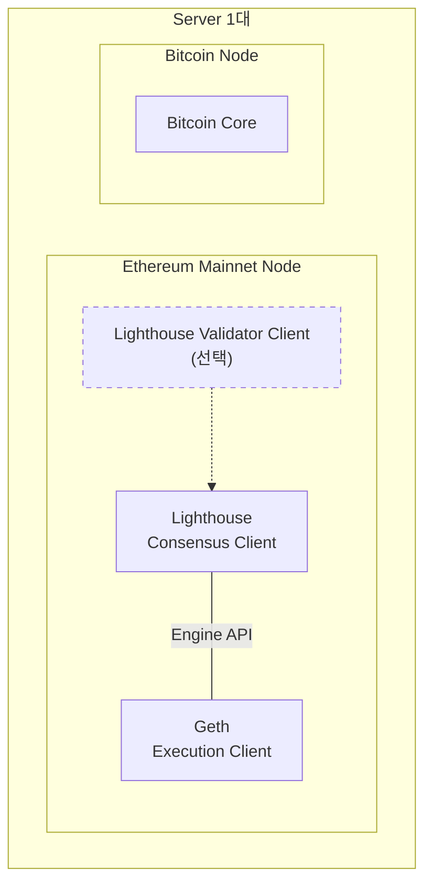

## Client, Node, Server

- **Client**: Protocol 규칙을 Code로 구현한 Software. Binary나 Source Code로 배포한다.
    - 관리: 설치, Version Update, Hard Fork(규칙이 바뀌는 Network Upgrade) 대응.

- **Node**: Client를 특정 Network 설정과 Data로 실행해 다른 Node와 연결된 실행 단위.
    - 관리: Sync(동기화, 최신 Block까지 따라잡는 과정) 진행 상황, Peer(직접 연결된 다른 Node) 연결, RPC(Remote Procedure Call, 외부 Program의 조회와 전송 요청 Interface) 응답 감시.

- **Server**: Node를 실행하는 Computer. 한 Server에서 여러 Node를 실행할 수 있다.
    - 관리: CPU(Central Processing Unit), Memory, Disk, Network 자원.

- 장애는 Node 단위로 드러나지만 원인은 셋 중 어디에도 있을 수 있다. Client Bug, 잘못된 설정, Server 자원 부족이 모두 Sync 지연으로 나타난다.
- 이 문서는 Ethereum과 Bitcoin 기준이다. 수치와 Flag는 2026년 11월 17일에 공식 문서와 Source Code로 확인한 값이며 시간이 지나면 바뀐다.

 

## Client

### What is a Client?

Protocol은 문서로 된 명세일 뿐 실행되지 않는다. 명세를 Code로 옮겨 Block을 검증하고 Peer와 통신하고 Data를 저장하는 Software가 Client다. [Ethereum.org](https://ethereum.org/developers/docs/nodes-and-clients/)는 Client를 Protocol 규칙에 따라 Data를 검증하는 Ethereum 구현체로 정의한다.

### Why Client Diversity Matters

같은 Protocol을 여러 팀이 따로 구현할 수 있다. 구현이 여럿 있고 Node들이 그 구현들에 고르게 나뉘어 있는 상태를 Client Diversity(클라이언트 다양성)라고 한다. 한 Client의 Bug가 Network 전체로 번지지 않으려면 그 Client의 점유율이 낮아야 한다. 효과는 구현의 개수가 아니라 점유율 분포에서 나온다. Ethereum의 PoS(Proof of Stake, 지분증명) 합의로 이유를 설명한다.

**Ethereum의 Finality가 정해지는 방식** ([Ethereum.org PoS 문서](https://ethereum.org/developers/docs/consensus-mechanisms/pos/))

- Validator(검증자): ETH(Ether, Ethereum의 기본 화폐)를 예치하고 Block 제안과 투표로 합의에 참여하는 주체. 예치한 ETH가 Stake(지분)다.

- Slot(슬롯): 12초 길이의 시간 단위. Slot마다 Block 하나를 제안할 수 있다.

- Epoch(에포크): 32 Slot, 즉 6.4분.

- Checkpoint(체크포인트): 각 Epoch의 첫 Slot에 있는 Block. 그 Slot이 비어 있으면 그 이전의 가장 최근 Block이다. [Consensus 명세](https://ethereum.github.io/consensus-specs/specs/phase0/beacon-chain/)

- Justified(정당화): Validator는 Checkpoint 두 개를 한 쌍(Source와 Target)으로 투표한다. 이미 Justified 된 Source에서 Target으로 가는 표가 전체 Stake의 2/3 이상이면 Target이 Justified 된다.

- Finalized(완결): Justified 된 Checkpoint의 바로 다음 Epoch Checkpoint도 Justified 되면 앞의 Checkpoint가 Finalized 된다. Finalized Block을 되돌리려면 전체 Stake의 1/3 이상이 Slashing(슬래싱, 규칙 위반에 대한 예치금 삭감과 퇴출)을 당해야 한다. 이 성질이 Finality(완결성)다.

**점유율이 문제가 되는 이유**

Justified와 Finalized 모두 Stake 2/3 이상의 투표가 필요하다.

- 한 Consensus Client의 점유율이 1/3을 넘는 경우: 그 Client에 Bug가 생기면 나머지만으로 2/3를 채우지 못해 Finality가 멈춘다. 4 Epoch 넘게 Finality가 없으면 Inactivity Leak(비활성 누출)이 작동한다. 투표하지 않는 Validator의 Stake가 조금씩 줄어들고, 남은 Validator가 2/3를 차지하면 Finality가 회복된다. [Ethereum.org](https://ethereum.org/developers/docs/consensus-mechanisms/pos/rewards-and-penalties/)

- 한 Consensus Client의 점유율이 2/3 이상인 경우: 그 Client만으로 2/3를 채우므로 Bug가 있는 Chain이 Finalized 될 수 있다. 그 Chain에 선 Validator가 올바른 Chain으로 돌아오려면 Slashing을 당하거나 느리고 비용이 큰 인출과 재활성화를 거쳐야 한다. [Ethereum.org](https://ethereum.org/developers/docs/nodes-and-clients/client-diversity/)

**목표**

- [Ethereum.org](https://ethereum.org/developers/docs/nodes-and-clients/client-diversity/)는 어떤 Consensus Client도 전체 Node의 33%에 이르지 않는 것을 이상적인 상태로 제시한다. Execution Client도 어떤 Client가 Network의 33%를 넘지 않는 것이 이상적이라고 적는다.
- 문서는 "Node의 33%"로 표현하지만 투표의 무게는 Node 수가 아니라 Stake다. 정확한 기준은 Stake 비중이다.
- 현재 점유율은 [Clientdiversity.org](https://clientdiversity.org/)에서 확인한다.

### Clients by Implementation

| Chain | Client | 실행 파일 또는 구성 |
| --- | --- | --- |
| Bitcoin | [Bitcoin Core](https://bitcoincore.org/) | `bitcoind` |
| Ethereum | Execution Client: [Geth](https://geth.ethereum.org/), [Nethermind](https://www.nethermind.io/nethermind-client), [Besu](https://besu.hyperledger.org/), [Erigon](https://github.com/erigontech/erigon), [Reth](https://reth.rs/), [ethrex](https://ethrex.xyz/) / Consensus Client: [Lighthouse](https://lighthouse.sigmaprime.io/), [Prysm](https://prysm.offchainlabs.com/docs/), [Teku](https://consensys.io/teku), [Nimbus](https://nimbus.team/), [Lodestar](https://github.com/ChainSafe/lodestar), [Grandine](https://docs.grandine.io/) | Execution Client 1개와 Consensus Client 1개를 연결 |
| BSC(BNB Smart Chain) | [BSC Geth](https://github.com/bnb-chain/bsc), [Reth-BSC](https://github.com/bnb-chain/reth-bsc), [BSC Erigon](https://github.com/node-real/bsc-erigon)(2025년 말 지원 종료) | BSC Geth는 Geth Fork, Reth-BSC는 Reth 기반, BSC Erigon은 Erigon Fork |
| Base | [`base-reth-node`, `base-consensus`](https://github.com/base/base) | Execution Client와 Consensus Client |
| Solana | [Agave](https://github.com/anza-xyz/agave) 등 | `agave-validator` |
| Aptos | [Aptos Core](https://github.com/aptos-labs/aptos-core) | `aptos-node` |
| Sui | [Sui](https://github.com/MystenLabs/sui) | `sui-node` |
| TRON | [java-tron](https://github.com/tronprotocol/java-tron) | `FullNode.jar` |
| XRP Ledger | [`xrpld`](https://github.com/XRPLF/rippled)(이전 이름 `rippled`), [Clio](https://github.com/XRPLF/clio) | `xrpld`는 P2P(Peer-to-Peer) Mode Server, Clio는 API(Application Programming Interface) 전용 Server |

**참고**

- Ethereum 목록은 [Nodes and Clients 문서](https://ethereum.org/developers/docs/nodes-and-clients/)의 표와 같다. ethrex는 이 표에는 있지만 [Client Diversity 문서](https://ethereum.org/developers/docs/nodes-and-clients/client-diversity/)의 점유율 집계(2025년 10월 26일 자료)에는 없다.

- XRP Ledger의 `rippled`는 [Version 3.2.0](https://xrpl.org/blog/2026/xrpld-3.2.0)(2026년 6월)에서 `xrpld`로 이름이 바뀌었다. 기본 설정 경로와 Database 경로도 함께 바뀌었다.

- BSC 문서는 Full Node에 BSC Geth를, Archive Node에 BSC Erigon을 [안내한다](https://docs.bnbchain.org/bnb-smart-chain/developers/node_operators/archive_node/). 그러나 [BSC Erigon 저장소](https://github.com/node-real/bsc-erigon)는 2025년 말로 개발과 유지보수를 끝내고 보관 처리되었고, 저장소 공지는 Reth-BSC로 옮기라고 권한다. 문서와 저장소 공지가 어긋나므로 Archive Node를 새로 구성할 때는 Reth-BSC를 먼저 확인한다.

### Clients by Role: Ethereum

Bitcoin Core는 Program 하나가 Node의 일을 모두 맡는다. Ethereum은 2022년 9월 The Merge(머지)로 PoS로 전환한 뒤부터 Node 하나에 Client 2개가 필수다. [Node Architecture 문서](https://ethereum.org/developers/docs/nodes-and-clients/node-architecture/)

**State**

- 특정 Block 시점의 전체 장부.

- Ethereum: 계정별 잔액, Nonce(논스), Contract Code와 Contract Storage. 계정의 Nonce는 일반 계정에서는 보낸 Transaction 수, Contract 계정에서는 생성한 Contract 수에 1을 더한 값이다. [Ethereum.org](https://ethereum.org/developers/docs/accounts/)

- Bitcoin: UTXO(Unspent Transaction Output, 아직 쓰이지 않은 Transaction 출력)의 집합.

**Client의 역할**

- **Execution Client(실행 클라이언트)**: Transaction을 EVM(Ethereum Virtual Machine)에서 실행하고, State와 Transaction Pool을 보관하며, 외부에 JSON-RPC(JavaScript Object Notation RPC)를 제공한다. 필수.

- **Consensus Client(합의 클라이언트)**: PoS 합의를 실행한다. Peer에게서 Block을 받고, Fork Choice(여러 갈래 중 따를 Chain을 고르는 규칙)로 Chain의 Head를 정한다. 필수.

- **Engine API**: Consensus Client가 Execution Client를 구동하는 Local RPC 연결. Consensus Client가 받은 Block의 실행 부분을 넘기면 Execution Client가 실행해 유효 여부를 답한다.

- Validator Client(검증자 클라이언트): Staking을 할 때만 추가한다. Validator 서명 Key로 Block 제안과 Attestation(어테스테이션, Block에 대한 투표)을 처리한다. 선택.

**실행 방식**

- 두 필수 Client는 각자의 P2P Network를 쓴다. Execution Client는 Transaction을, Consensus Client는 Block과 Attestation을 전파한다.
- [Lighthouse](https://lighthouse-book.sigmaprime.io/)는 Consensus Client와 Validator Client를 별도 Process로 실행한다. [Teku](https://docs.teku.consensys.io/)와 [Nimbus](https://nimbus.guide/)는 한 Process로 함께 실행할 수 있다.

### Clients by Verification Scope: Full Client and Light Client

**용어**

- Hash: Data를 고정 길이 값으로 바꾼 결과. 원래 Data가 조금만 달라져도 값이 달라진다.

- Block Header: Block의 요약 정보. 이전 Block의 Hash와 Block 안 Data를 요약한 값이 들어 있다.

- Merkle Root: 많은 Data를 Hash Tree로 묶어 하나의 Hash로 요약한 값.

- Merkle Proof: 어떤 Data가 그 Tree에 포함되는지를 Tree의 일부 경로만으로 증명하는 것.

- Bitcoin Header에는 Transaction의 Merkle Root가 들어 있다. Ethereum Header에는 State 전체를 요약한 State Root(상태 루트)도 들어 있다.

**두 종류**

- Full Client: 받은 Block을 모두 직접 실행해 검증한다.

- Light Client: Block Header와 Merkle Proof만 확인한다. Light Client를 실행하는 Node가 Light Node다.

- Ethereum의 Light Client는 Full Client와 별도 구현인 경우가 많다. [Ethereum.org](https://ethereum.org/developers/docs/nodes-and-clients/light-clients/)는 Lodestar, Helios, Nimbus의 Light Client와 개발 중인 Geth Light Mode를 예로 든다.

 

## Node

### What is a Node?

같은 Client도 Mainnet 설정이면 Mainnet Node, Testnet 설정이면 Testnet Node가 된다. [Ethereum.org](https://ethereum.org/developers/docs/nodes-and-clients/)는 Node를 다른 Computer와 연결되어 Network를 이루는 Client Software의 Instance로 정의한다.

**Node가 하는 일** (범위는 종류에 따라 다르다)

- P2P 연결: 중앙 Server 없이 다른 Node와 직접 Data를 주고받는다.
- 수신과 검증: Block과 Transaction이 Protocol 규칙에 맞는지 확인하고 다른 Node에 전달한다.
- 저장: Block과 State를 Disk에 보관한다.
- RPC 응답: `bitcoind`는 JSON-RPC를 [기본으로 켜고](https://github.com/bitcoin/bitcoin/blob/master/src/bitcoind.cpp) Localhost(같은 Computer 안)에서만 받는다. Geth는 HTTP(HyperText Transfer Protocol) JSON-RPC를 `--http`로 따로 켜야 하고 이때도 Localhost에서만 받는다. 외부 공개는 어느 쪽이든 운영자가 따로 설정한다.

### Node Types

Node 종류는 서로 독립인 두 Criterion(기준)으로 나눈다.

- Criterion 1: 어디까지 스스로 검증하고 무엇을 얼마나 저장하는가.
    - 검증 수준: Full(직접 검증)과 Light(Header와 Proof만 확인).
    - 저장 범위: Full Node 안에서 Archive(과거 State까지 보관), 기본, Pruned(오래된 Data 삭제)로 갈린다. Archive Node와 Pruned Node도 직접 검증하므로 Full Node에 속한다.

- Criterion 2: Network에서 어떤 역할을 맡는가. Validator, Mining, RPC.

- Node 하나는 Criterion 1에서 검증 수준 하나와 저장 범위 하나를 갖는다. Criterion 2의 역할은 없거나 여러 개일 수 있다. 예를 들어 Archive Node이면서 RPC Node일 수 있다.

### Criterion 1. 검증 수준과 저장 범위

#### Full Node

수신하는 Block을 합의 규칙에 따라 스스로 검증하는 Node다. 기준은 저장량이 아니라 **직접 검증 여부**다. 아래 저장 내용은 저장 범위를 따로 바꾸지 않은 기본 설정 기준이다.

**검증**

- Block이 합의 규칙을 지키는지 확인하고, Transaction을 직접 실행해 State를 갱신한다.
- Ethereum은 실행 결과 State가 Header의 State Root와 일치하는지도 확인한다.

**저장**

- Ethereum State: 최근 128 Block(12초 간격으로 약 25.6분)의 State만 보관하고 그보다 오래된 State는 삭제한다. [Ethereum.org](https://ethereum.org/developers/docs/nodes-and-clients/archive-nodes/)는 Full Node가 보관한 Block을 다시 실행해 오래된 State를 만들 수 있지만 계산이 많이 든다고 적는다. Geth는 [v1.14.0](https://github.com/ethereum/go-ethereum/releases/tag/v1.14.0)부터 Path-Based 저장이 기본이다. 이 방식은 Head에서 128 Block 뒤 시점의 State 하나를 Disk에 두고, 그보다 과거로 되돌리기 위한 State History(Block별 역방향 변경분)를 기본 90,000 Block만큼 보관한다. State History로 과거 State를 조회하려면 `--gcmode archive`로 Index를 만들어야 한다([Geth Archive 문서](https://geth.ethereum.org/docs/fundamentals/archive)). 과거 State를 조회할 일이 있으면 Archive Node로 계획한다.

- Ethereum Block 이력: 2025년 7월 8일부터 모든 Execution Client가 [EIP(Ethereum Improvement Proposal)-4444](https://eips.ethereum.org/EIPS/eip-4444)에 따른 Partial History Expiry(부분 이력 만료)를 지원한다. The Merge 이전 Block Body(블록 본문, Transaction 목록)와 Receipt(영수증, 실행 결과 기록)를 삭제할 수 있고 Mainnet 기준 300에서 500GB(Gigabyte)가 줄어든다. Header는 모두 유지하므로 Genesis Block(제네시스 블록, 첫 Block)부터 Chain을 검증할 수 있다. Nethermind는 1.32.2부터 기본으로 켜져 있고 새로 Sync하는 Node에만 적용된다. Geth는 기본값이 전체 보관(`--history.chain all`)이다. [EF(Ethereum Foundation) Blog](https://blog.ethereum.org/2025/07/08/partial-history-exp)

- Bitcoin Core: 기본 설정(`-prune=0`)은 모든 Block을 보관한다.

**최초 Sync의 예외** (Sync 후 새 Block은 모두 직접 검증한다)

- Ethereum Execution Client: Full Sync는 Genesis부터 모든 Block을 실행한다. Snap Sync는 Genesis가 아니라 비교적 최근 Block에서 시작한다. Header를 받아 검증하고, Block Body와 Receipt를 받으면서, 최근 State를 다른 Node에서 Proof와 함께 받아 State Tree를 직접 다시 만든다. 따라잡은 뒤에는 Block을 하나씩 실행한다. Geth 기본값은 Snap Sync다. [Geth Sync Mode](https://geth.ethereum.org/docs/fundamentals/sync-modes)

- Ethereum Consensus Client: Checkpoint Sync(Weak Subjectivity Sync)로 신뢰하는 출처에서 최근 Finalized State를 받아 그 지점부터 검증한다. Genesis부터 받지 않는 대신 그 출처를 신뢰한다.

- Bitcoin Core: 기본으로 켜진 `assumevalid`는 [Source Code에 지정된 Block](https://github.com/bitcoin/bitcoin/blob/master/src/kernel/chainparams.cpp)과 그 조상 Block의 Script(서명) 검증만 생략한다. `-assumevalid=0`으로 끄면 전부 검증한다. [`init.cpp`](https://github.com/bitcoin/bitcoin/blob/master/src/init.cpp)

#### Archive Node

Full Node Data에 더해 모든 과거 Block 시점의 State를 보관하는 Node다. 검증은 Full Node와 같다.

**용도와 성격**

- 과거 시점의 계정 잔액 조회, 과거 Transaction의 Tracing(실행 과정 추적). Block Explorer, 지갑 Service, Chain 분석에 쓴다.

- 과거 State는 Network 동작에 필요하지 않고, Network는 Archive Node에 의존하지 않는다. [Ethereum.org](https://ethereum.org/developers/docs/nodes-and-clients/archive-nodes/)

**Disk 사용량** (Ethereum Mainnet, Version과 시점에 따라 바뀐다)

- Erigon, Reth, Geth(Path-Based Archive): 약 2에서 3TB(Terabyte). Besu, Nethermind: 12TB 이상. [Ethereum.org](https://ethereum.org/developers/docs/nodes-and-clients/archive-nodes/)

- Geth는 Archive 방식이 둘이다. 기존 Hash-Based는 20TB를 넘을 수 있다. v1.16.0의 Path-Based는 약 2TB이고, 과거 시점의 Merkle Proof(`eth_getProof`)까지 제공하려면 v1.17.x부터 `--history.trienode`를 설정하며 약 6.5TB가 든다. [Geth Archive 문서](https://geth.ethereum.org/docs/fundamentals/archive)

**Bitcoin**

- Bitcoin Core의 저장 설정은 Block 보관 범위(`-prune`)다. 과거 시점의 UTXO 집합을 보관하는 설정은 문서에 없다.
- Pruning하지 않는 Node만 [`NODE_NETWORK`](https://github.com/bitcoin/bitcoin/blob/master/src/protocol.h)를 알리고 전체 Block을 제공한다. Bitcoin에서 "Archive"라고 하면 State 보관이 아니라 이 전체 Block 보관을 가리킨다.

#### Pruned Node

Pruning(프루닝)은 더 필요 없는 오래된 Data를 지워 저장 공간을 줄이는 것이다. 삭제 전에 검증하므로 검증 수준은 Full Node와 같다. Pruned Node라는 분류는 Bitcoin 기준이다.

**Bitcoin Core** ([`validation.h`](https://github.com/bitcoin/bitcoin/blob/master/src/validation.h), [`init.cpp`](https://github.com/bitcoin/bitcoin/blob/master/src/init.cpp))

- 오래된 Block File을 삭제하고 Header 전체, 최근 Block, UTXO 집합을 유지한다.
- `-prune=<n>`: Block File을 n MiB(Mebibyte, 2^20 Byte) 아래로 유지한다. 최솟값은 550MiB다. 기준은 Block 수가 아니라 용량이다.
- 최근 288 Block이 든 File은 삭제하지 않는다. 다른 Node에는 [`NODE_NETWORK_LIMITED`](https://github.com/bitcoin/bitcoin/blob/master/src/protocol.h)([BIP(Bitcoin Improvement Proposal)-159](https://github.com/bitcoin/bips/blob/master/bip-0159.mediawiki))를 알려 최근 288 Block(약 2일분)만 제공한다.
- `-txindex`와 함께 쓸 수 없다. Pruning을 끄려면 Blockchain 전체를 다시 내려받아야 한다.

**Ethereum**

- 공식 분류(Light, Full, Archive)에 Pruned Node는 없다. Archive가 아닌 Node는 모두 오래된 State를 Pruning한다.
- Geth 문서는 The Merge 이전 이력을 지우는 것을 [History Pruning](https://geth.ethereum.org/docs/fundamentals/historypruning)이라고 부른다. Ethereum에서 "Pruning"이라는 말이 나오면 State 정리인지 이력 삭제인지 확인한다.

#### Light Node

Header 수준의 Data만 받고 나머지는 Full Node에 요청하는 Node다. 받은 Data는 Header의 Root Hash와 대조해 스스로 확인한다. Full Node에 맡기는 것은 Data이고 검증이 아니다.

**받는 Data**

- Bitcoin SPV(Simplified Payment Verification): Genesis부터 전체 Header Chain.
- Ethereum: 모든 Header를 받지 않는다. 최근 Header와 Sync Committee 정보만 유지한다.

**확인하는 것과 못하는 것**

- 확인: Header 유효성, 받은 Data의 Merkle Proof(예: Transaction 포함 여부, 계정 잔액).
- 확인 불가: State 전이의 정당성. Transaction을 실행하지 않기 때문이다.

**Header 유효성의 근거**

- Bitcoin: PoW(Proof of Work, 작업증명)가 가장 많이 쌓인 Header Chain을 따른다. [White Paper 8장](https://bitcoin.org/bitcoin.pdf)은 정직한 Node가 Network를 통제하는 동안에만 이 검증을 믿을 수 있다고 적는다.

- Ethereum: 2021년 10월 Altair Upgrade에서 Sync Committee(동기화 위원회)를 도입했다. 256 Epoch(약 1.1일)마다 무작위로 뽑힌 Validator 512명이 최근 Header에 서명한다. Light Client는 위원회 2/3 이상이 서명한 Header를 Finalized Header로 받아들인다. [Altair 명세](https://ethereum.github.io/consensus-specs/specs/altair/light-client/sync-protocol), [Ethereum.org](https://ethereum.org/developers/docs/nodes-and-clients/light-clients/)

**한계**

- Data는 Full Node에 의존한다.
- Header 신뢰는 Bitcoin에서는 채굴력 다수의 정직함에, Ethereum에서는 Sync Committee 512명 중 2/3의 정직함에 의존한다. Ethereum의 [Slashing 조건 세 가지](https://ethereum.org/developers/docs/consensus-mechanisms/pos/rewards-and-penalties/)(같은 Slot에 Block 두 개 제안, 이중 투표, 다른 투표를 감싸는 투표)에 Sync Committee 서명은 들어 있지 않다. 잘못된 Header에 서명해도 불이익이 없다는 점은 [Consensus 명세 저장소의 Issue](https://github.com/ethereum/consensus-specs/issues/3321)로 남아 있다.
- 합의에 참여하지 않으며 Validator가 될 수 없다.
- Ethereum.org는 목록에 든 Light Client 가운데 Production 수준으로 볼 만한 것이 아직 없다고 적는다. [Ethereum.org](https://ethereum.org/developers/docs/nodes-and-clients/light-clients/)

### Criterion 2. Network 내 역할

#### Validator Node

PoS Chain에서 Block 제안과 투표로 합의에 참여하는 Node다. Stake를 예치한다.

**Ethereum**

- 구성: Execution Client + Consensus Client + Validator Client. [Ethereum.org](https://ethereum.org/developers/docs/consensus-mechanisms/pos/)
- 활성화에 최소 32 ETH가 필요하다.
- 2025년 5월 [Pectra](https://ethereum.org/roadmap/pectra/) Upgrade의 [EIP-7251](https://eips.ethereum.org/EIPS/eip-7251)로 Validator 하나가 합의에서 인정받는 잔액의 상한(Max Effective Balance)이 2048 ETH로 올라갔다. 이 상한은 Compounding(0x02) 출금 설정을 쓰는 Validator에만 적용된다. 최소 예치는 32 ETH 그대로다.
- 처벌: Penalty(패널티, 투표 누락 등에 대한 소액 차감)와 Slashing(예치금 삭감 후 [Validator 집합에서 퇴출](https://ethereum.org/developers/docs/consensus-mechanisms/pos/rewards-and-penalties/)). 다른 Chain의 조건은 해당 문서로 확인한다.

**저장 범위**

- Block을 직접 검증해야 하므로 Full Node다. Light Node는 불가하다.

#### Mining Node

PoW Chain에서 후보 Block을 만들고 Nonce를 탐색해 Block을 생성하는 Node다. 여기서 Nonce는 Header Hash가 난이도 조건을 만족할 때까지 바꿔 넣는 값이다. Ethereum 계정의 Nonce와는 이름만 같다.

- 저장 범위: 후보 Block을 만들려면 UTXO 집합과 Mempool(멤풀, 대기 중인 Transaction 모음)이 필요하므로 Full Node다. Bitcoin Core는 [`getblocktemplate`](https://github.com/bitcoin/bitcoin/blob/master/src/rpc/mining.cpp)로 후보 Block Template을 준다. 이 RPC에는 Pruning 여부 검사가 없으므로 Pruned Node도 Template을 만들 수 있다.

- Mining Pool(마이닝 풀): 보통 Pool Server가 채굴 작업(Job)을 만들어 채굴기에 나눠 준다. 이 경우 채굴기는 Client를 실행하지 않으므로 Node가 아닐 수 있다. Stratum V2의 Job Declaration Protocol을 쓰면 채굴자 쪽이 자기 Template Provider(보통 Bitcoin Core Node)가 만든 Template을 Pool에 신고해 쓸 수 있다. [Stratum V2 명세](https://stratumprotocol.org/specification/03-protocol-overview/)

- Ethereum은 The Merge 이후 Mining Node가 없다.

#### RPC Node

외부 Application(지갑, DApp(Decentralized Application, 탈중앙화 애플리케이션), Backend Server)의 조회와 Transaction 전송 요청을 처리하는 Node다. Localhost에서만 RPC를 받는 Node는 여기에 넣지 않는다.

- 저장 범위: 최신 State만 조회하면 Full Node, 과거 State를 조회하면 Archive Node.

- Ethereum: Geth는 기본 설정에서 최근 2,350,000 Block의 Transaction Index만 유지한다(`--history.transactions`). 전체 Chain의 Transaction을 Hash로 조회하려면 이 값을 0으로 둔다. [Geth Command-line Options](https://geth.ethereum.org/docs/fundamentals/command-line-options)

- Ethereum: Partial History Expiry를 켠 Node는 The Merge 이전 Body와 Receipt를 갖고 있지 않다. Geth에는 이 경우에 쓰는 오류 `pruned history unavailable`(Code 4444)이 [정의되어 있다](https://github.com/ethereum/go-ethereum/blob/master/core/history/historymode.go).

- Bitcoin: [`getrawtransaction`](https://github.com/bitcoin/bitcoin/blob/master/src/rpc/rawtransaction.cpp)은 `-txindex`가 없으면 Mempool의 Transaction만 찾는다. 임의의 과거 Transaction을 ID(Identifier)만으로 조회하려면 `-txindex`가 필요하고, `-txindex`는 Pruning과 함께 쓸 수 없다.

- Load Balancer 구성은 Node 속성이 아니라 운영 Infrastructure다.

### What Determines a Node Type?

**실행 Option**

- 대부분 별도 Software가 아니라 같은 Client의 Option으로 정해진다. Bitcoin Core `-prune`, Geth `--gcmode archive --history.state=0`, Solana Agave `--no-voting`, TRON `FullNode.jar --witness`.

**되돌릴 수 없는 것**

- 보관 범위를 줄였다 늘려도 지운 Data는 돌아오지 않는다. Bitcoin Core는 전체를 다시 내려받아야 하고, [Geth 문서](https://geth.ethereum.org/docs/fundamentals/archive)도 지운 과거 State는 복구할 수 없다고 적는다. 보관 범위는 Sync 전에 정한다.

**예외**

- Light Client는 별도 구현인 경우가 많다.
- Archive Node는 Client마다 Disk 차이가 커서 Client를 따로 고르기도 한다. [Ethereum.org](https://ethereum.org/developers/docs/nodes-and-clients/archive-nodes/)는 Erigon을 쓰는 것이 가장 실용적인 방법이라고 적는다.

### Nodes by Chain

| Chain | 공식 문서의 Node 종류 | 두 Criterion으로 보면 |
| --- | --- | --- |
| Bitcoin | Full Node, Pruned Node(`-prune`) | Criterion 1 구분. Mining은 역할로 더해짐 |
| Ethereum | Full, Archive, Light | Criterion 1 구분. Validator는 Validator Client를 더한 역할 |
| BSC | Fast, Full, Archive, Validator | Fast Node는 Full Node에서 State Root 검증을 끈 형태 |
| Base | Minimal, Full, Archive(Snapshot 구분) | Criterion 1의 저장 범위 구분. 구성은 Ethereum처럼 두 Client |
| Solana | Validator, RPC Node | 같은 Software. 투표하면 Validator, `--no-voting`이면 RPC Node |
| Aptos | Validator Node, VFN(Validator Full Node), PFN(Public Full Node) | VFN과 PFN은 기능이 같고 Sync 대상만 다름 |
| Sui | Validator, Full Node | Full Node는 설정한 보관 기간 밖 Data 삭제. 그 이전은 Archival Service |
| TRON | Fullnode, Lite Fullnode | Lite는 저장 축소. SR(Super Representative)은 Fullnode에 Block 생산 역할 추가 |
| XRP Ledger | P2P Mode Server(Stock Server), Validator, API Server, Hub Server | 하나의 P2P Mode Server에 역할을 설정으로 추가 |

**Chain별 보충**

- BSC: Fast Node는 `--tries-verify-mode none`을 붙인 Full Node다. [State Root를 뺀 나머지만 검증하므로](https://docs.bnbchain.org/docs/BSC-separate-node/) State 일관성을 덜 따지는 대신 빠르다. [한 번 Fast로 실행하면](https://docs.bnbchain.org/bnb-smart-chain/developers/node_operators/fast_node/) Full로 되돌릴 수 없고 Snapshot을 다시 받아야 한다. [Archive Node](https://docs.bnbchain.org/bnb-smart-chain/developers/node_operators/archive_node/)는 `--gcmode archive`를 붙인 Full Node로 정의된다. 문서가 안내하는 BSC Erigon은 지원이 끝났다(위 Clients by Implementation 참고).

- Base: [`base-consensus`](https://docs.base.org/specifications/node-operators/run-a-node)는 Sequencer(시퀀서, L2(Layer 2)에서 Transaction 순서를 정하는 주체)가 전파한 Block을 먼저 받고, 이후 L1(Layer 1)에 게시된 Data로 같은 Block을 도출한다. [Snapshot](https://docs.base.org/specifications/node-operators/snapshots)은 Minimal, Full, Archive로 나뉜다. 예전 저장소 [`base/node`](https://github.com/base/node)는 보관 처리되었고 현재는 [`base/base`](https://github.com/base/base)다.

- Solana: [RPC Node](https://docs.anza.xyz/operations/setup-an-rpc-node)는 Validator와 같은 Process를 `--no-voting`으로 실행하며 투표 계정이 필요 없다. 2026년 10월 21일 [Alpenglow](https://solana.com/upgrades/alpenglow) 활성화 이후 투표하는 Validator는 Epoch마다 0.8 SOL을 Vote Account에서 낸다(금액은 Solana 공식 Upgrade 문서 기준). RPC Node에는 해당하지 않는다.

- Aptos: [Validator](https://aptos.dev/network/nodes)는 최소 Stake를 예치하고 합의에 참여한다. VFN은 Validator 운영자만 운영하며 Validator에서 직접 Sync한다. PFN은 누구나 운영하며 [다른 Full Node에서 Sync한다](https://aptos.dev/network/blockchain/fullnodes).

- Sui: [Full Node](https://docs.sui.io/operators/full-node/sui-full-node)는 Validator가 서명한 Checkpoint의 서명을 확인하고 Transaction을 재실행해 결과를 대조한다. 합의에는 참여하지 않는다. 보관 기간 밖 Data 요청에는 `NOT_FOUND`를 돌려주며 그 Data는 [Archival Service](https://docs.sui.io/develop/accessing-data/archival-store)에 요청한다.

- TRON: [Lite Fullnode](https://developers.tron.network/docs/nodes-and-clients)는 현재 State와 최근 65,536 Block을 담은 Snapshot에서 시작하고 과거 조회 API는 기본으로 꺼져 있다. SR Node는 Fullnode에 `--witness`와 서명 Key를 더한 것이고 Block 생산은 [투표 상위 27개 SR](https://developers.tron.network/docs/super-representatives)이 맡는다.

- XRP Ledger: [Stock Server](https://xrpl.org/docs/concepts/networks-and-servers/xrpld-server-modes)는 설정을 거의 바꾸지 않은 P2P Mode Server다. Validation은 기본으로 꺼져 있어 Validator는 따로 설정한다. 전체 이력을 보관하는 API Server를 Full History Server라고 부른다. Clio는 API 전용이다.

**정리**

- Solana, Aptos, Sui는 역할 중심으로 나눈다. BSC, TRON은 검증과 저장 범위 중심이다. XRP Ledger는 설정으로 역할을 더한다. Ethereum, Base는 Node 하나가 두 Client다.

 

## Example: Server 1대, Node 2개, Client 3개

Ethereum Mainnet Node(Geth + Lighthouse)와 Bitcoin Node(Bitcoin Core)를 한 Server에서 실행한다. Validator Client를 더하면 Client는 4개다.

**관리 대상**

- Geth나 Lighthouse Version Update: Client 작업. Hard Fork 때 둘 다 확인한다.
- Ethereum Node가 최신 Block을 못 따라감: Node 증상. 원인은 Client Bug, 설정, Server 자원 어디든 가능하다.
- Disk 부족: 두 Node가 함께 영향을 받는 Server 문제.

**Geth 설정과 Node 종류** (v1.16.0 이상)

| 설정 | Criterion 1 | Criterion 2 |
| --- | --- | --- |
| 기본 | Full Node(Snap Sync) | 없음 |
| `--history.chain postmerge` | Full Node, The Merge 이전 Body와 Receipt 미보관 | 없음 |
| `--syncmode full --gcmode archive --history.state=0` | Archive Node(Path-Based) | 없음 |
| `--http` | 변화 없음 | 없음(Localhost에서만 수신) |
| `--http --http.addr <주소>` | 변화 없음 | RPC Node |
| Lighthouse Validator Client + 32 ETH 예치 | 변화 없음 | Validator Node |

- `--history.state=0`은 모든 과거 State를 유지한다. 지정하지 않으면 기본값은 90,000 Block이다. `--gcmode archive`는 과거 State Index를 켠다. Geth 문서는 Full Sync를 먼저 끝낸 뒤 켜는 것을 권장한다. [Geth Archive 문서](https://geth.ethereum.org/docs/fundamentals/archive)
- Command-line Options 문서에는 `--gcmode`가 Hash-Based에서만 의미가 있다는 문구가 남아 있다. 현재 [Source Code](https://github.com/ethereum/go-ethereum/blob/master/cmd/utils/flags.go)의 설명에는 그 제한이 없고, [v1.16.0 Release Note](https://github.com/ethereum/go-ethereum/releases/tag/v1.16.0)도 `--gcmode=archive`를 Path-Based와 함께 쓴다고 적는다.
- `--history.chain`의 기본값은 `all`이다. `postmerge` 외에 `postprague` 같은 값도 [Source Code](https://github.com/ethereum/go-ethereum/blob/master/core/history/historymode.go)에 정의되어 있다.
- `--http.addr`의 기본값은 `localhost`다. Domain으로 접속받으려면 `--http.vhosts`(기본값 `localhost`)도 설정한다. [Geth Command-line Options](https://geth.ethereum.org/docs/fundamentals/command-line-options)

**Bitcoin Core 설정과 Node 종류**

| 설정 | 결과 |
| --- | --- |
| 기본 | Full Node. `NODE_NETWORK` 알림, 전체 Block 제공. RPC는 Localhost에서만 수신 |
| `-prune=550` | Pruned Node. 최근 288 Block만 제공, `-txindex` 불가 |
| `-rpcbind` + `-rpcallowip` | 외부 RPC 수신, RPC Node 역할 추가. [`-rpcbind`는 `-rpcallowip` 없이는 무시된다](https://github.com/bitcoin/bitcoin/blob/master/src/init.cpp) |

 

## Summary

- Client는 Software, Node는 Client를 설정과 Data로 실행한 단위, Server는 Computer다. Update는 Client, Sync와 감시는 Node, 자원은 Server 단위로 다룬다.
- Client Diversity의 효과는 구현 개수가 아니라 점유율에서 나온다. Ethereum은 Justified와 Finalized 모두 Stake 2/3가 필요하므로 한 Client의 점유율 1/3과 2/3가 경계다.
- Node 종류는 Criterion 1(검증 수준과 저장 범위)과 Criterion 2(Validator, Mining, RPC)로 정해지고 둘은 독립이다. 대부분 실행 Option으로 정해지며 지운 Data는 돌아오지 않는다.
- Full Node의 기준은 직접 검증이다. Archive와 Pruned는 Full Node의 저장 범위가 다른 형태다. Light는 Header와 Proof만 확인하고 Data를 외부에 의존한다.
- 같은 용어도 Chain마다 뜻이 다르다. Archive는 Ethereum에서 과거 State 보관이고, Bitcoin에서는 전체 Block 보관을 가리킨다. Pruned는 Bitcoin에서 오래된 Block 삭제이고 Ethereum 공식 분류에는 없다.
- Ethereum Validator는 Client 3개(Execution, Consensus, Validator)와 최소 32 ETH가 필요하다.