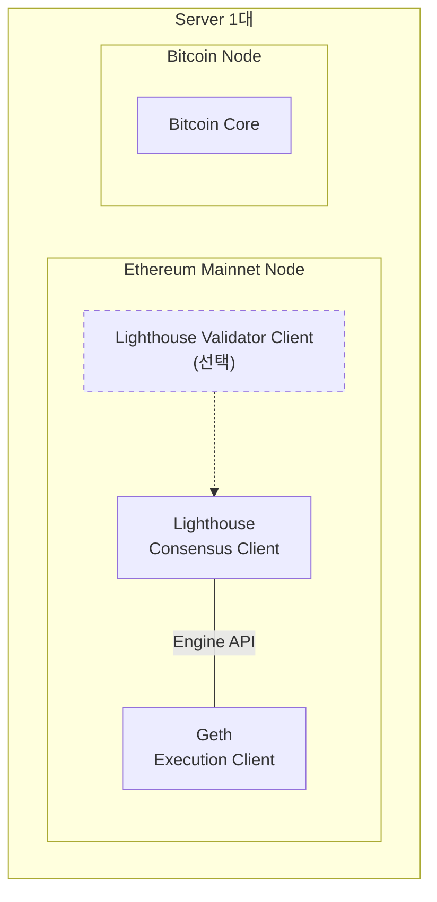

## Client, Node, Server

Blockchain(블록체인)에는 Data를 대신 관리해 주는 중앙 관리자가 없다. 참여자가 각자 Block(블록)과 Transaction(트랜잭션)을 받아 Protocol(프로토콜) 규칙에 맞는지 확인하고, 그 결과를 다른 참여자에게 전달한다. Protocol은 Block과 Transaction의 형식, 유효성 조건, 참여자끼리 주고받는 Message 규칙을 정한 명세다. 이렇게 Network에 참여하는 단위를 Node(노드)라고 한다.

"Node"라는 말은 흔히 세 가지를 섞어 가리킨다. Protocol을 구현한 Software, 그 Software를 실행해 Network에 연결된 실행 단위, 그것이 돌아가는 Computer다. 이 문서는 셋을 다음처럼 나눈다.

- Client(클라이언트): Protocol의 규칙을 Code로 구현한 Software다.
- Node: Client를 특정 Network 설정과 Data로 실행해, 다른 Node와 연결된 상태로 동작하는 실행 단위다.
- Server(서버): Node를 실행하는 Computer다. 물리 Server일 수도 있고 Cloud의 Virtual Machine(가상 머신)일 수도 있다. 한 Server에서 여러 Node를 실행할 수 있다. 예를 들어 Mainnet Node와 Testnet Node를 같은 Server에서 돌리면, 두 Node는 CPU(Central Processing Unit), Memory, Disk, Network Bandwidth를 나눠 쓴다.

셋을 구분해야 하는 이유는 관리하는 일이 다르기 때문이다. 구분하지 않으면 Update할 대상, 감시할 대상, 자원을 늘릴 대상이 섞인다. 아래 표에서 Sync(동기화)는 Node가 다른 Node에서 Data를 받아 Network의 최신 Block까지 따라잡는 과정이고, Peer는 Node와 직접 연결된 다른 Node다. RPC(Remote Procedure Call)는 외부 Program이 Node에 조회나 Transaction 전송을 요청하는 Interface다.

| 구분 | 무엇인가 | 관리하는 일 |
| --- | --- | --- |
| Client | Protocol을 구현한 Software | 설치, Version Update, Hard Fork(하드포크, 규칙이 바뀌는 Network Upgrade) 대응 |
| Node | Client를 설정과 Data로 실행한 단위 | Sync 진행 상황, Peer 연결, RPC 응답 감시 |
| Server | Node를 실행하는 Computer | CPU, Memory, Disk, Network 자원 |

장애는 Node 단위로 드러나지만 원인은 셋 중 어디에도 있을 수 있다. Client의 Bug, 잘못된 설정이나 손상된 Data, Server 자원 부족은 모두 Sync 지연 같은 Node의 증상으로 나타날 수 있다.

Node끼리도 서로 다르다. 어떤 Data를 얼마나 보관하는지, 받은 Data를 어디까지 스스로 검증하는지, Network에서 어떤 역할을 맡는지가 다르다. 이 차이를 알아야 필요한 기능에 맞는 Node를 고르고, 그 Node가 주는 보장의 한계를 알 수 있다. 아래에서는 Client를 먼저 설명하고, 이어서 Node와 그 종류를 설명한다.

설명과 예시는 Ethereum과 Bitcoin을 기준으로 한다. 다른 Chain은 같은 이름을 다른 뜻으로 쓸 수 있으므로, 해당 Chain의 문서로 정의를 확인해야 한다. Client Version, 기본 설정, Disk 사용량은 시간이 지나면 바뀌므로, 이 문서의 수치와 Flag는 2026년 11월에 확인한 공식 문서 기준이다.

용어 표기 원칙은 다음과 같다. Client, Node, Server와 Node 종류(Full Node 등), Client 종류(Execution Client 등)는 영어로 쓴다. 외래어로 쓰이는 기술 용어(Block, Transaction, Hash 등)도 영어로 쓴다. "검증"은 Data가 규칙에 맞는지 확인하는 행위를 뜻하고, 합의에 참여하는 주체는 Validator로 구분해 쓴다.

 

## Client

### What is a Client?

Client는 Blockchain Protocol의 규칙을 Code로 구현한 Software다. [Ethereum.org는 Client를](https://ethereum.org/en/developers/docs/nodes-and-clients/) Protocol 규칙에 따라 Data를 검증하는 Ethereum 구현체로 정의한다. Client는 실행 파일(Binary)이나 Source Code 형태로 배포된다.

### Why are Clients needed?

Protocol은 문서로 된 명세일 뿐이고, 그 자체로는 실행되지 않는다. 누군가는 명세를 Code로 옮겨 Block을 검증하고, Peer와 Message를 주고받고, Data를 저장하는 Software를 만들어야 한다. 이 Software가 Client다.

같은 Protocol을 여러 팀이 따로 구현할 수도 있다. 구현이 여럿 있고 Node들이 그 구현들에 고르게 나뉘어 있는 상태를 Client Diversity(클라이언트 다양성)라고 한다. Client Diversity가 있으면 한 Client에 Bug가 생겨도 그 Client를 쓰는 Node만 영향을 받는다. 이 효과는 구현의 개수가 아니라 점유율 분포에서 나온다. Ethereum의 PoS(Proof of Stake, 지분증명) 합의를 예로 들면 이유가 분명해진다.

PoS 합의에서는 ETH(Ether, Ethereum의 기본 화폐)를 예치하고 Block 제안과 투표로 합의에 참여하는 주체를 Validator(검증자)라고 한다. Block이 Finality(완결성)에 도달하려면, 전체 예치 Stake(지분)의 3분의 2 이상을 가진 Validator들이 같은 Checkpoint에 투표해야 한다. Finality는 Block이 되돌려지지 않는다고 확정된 상태다. 이 규칙에서 다음 기준이 나온다.

- 3분의 1을 넘게 쓰이는 Consensus Client(아래 'Client Types' 참고)에 Bug가 생기면, 나머지만으로는 3분의 2를 채우지 못해 Consensus Layer가 Finality에 도달하지 못할 수 있다. [Ethereum.org의 Client Diversity 문서](https://ethereum.org/developers/docs/nodes-and-clients/client-diversity/)는 이를 "Node의 33%를 넘는 Consensus Client"로 표현한다. 투표의 무게는 Node 수가 아니라 예치 Stake로 정해지므로, 정확한 기준은 Stake 비중이다.
- 3분의 2 이상이 쓰는 Client에 치명적인 합의 Bug가 생기면 잘못된 Chain이 완결될 수 있다. Finality에 필요한 3분의 2를 그 Client만으로 채울 수 있기 때문이다.
- 그래서 어떤 Consensus Client도 33%에 이르지 않는 것이 목표로 제시된다. 같은 문서는 Execution Client도 어떤 Client도 33%를 넘지 않는 분포가 이상적이라고 적고 있다. 현재 점유율은 [Clientdiversity.org](https://clientdiversity.org/)에서 확인할 수 있다.

### Client Types

Client는 세 가지 관점으로 나눠 볼 수 있다. 같은 Protocol을 누가 구현했는지(구현), Node 안에서 어떤 일을 맡는지(역할), 받은 Data를 어디까지 검증하는지(검증 범위)다.

#### Clients by Implementation

Chain마다 대표 Client와 실행 파일은 다음과 같다.

| Chain | Client | 실행 파일 또는 구성 |
| --- | --- | --- |
| Bitcoin | Bitcoin Core | `bitcoind` |
| Ethereum | Execution Client: Geth, Nethermind, Besu, Erigon, Reth / Consensus Client: Lighthouse, Prysm, Teku, Nimbus, Lodestar, Grandine | Execution Client 1개와 Consensus Client 1개를 연결 |
| BSC(BNB Smart Chain) | BSC Geth(`bnb-chain/bsc`), BSC Erigon | Geth 기반 Client로 Full Node 운영, Archive Node는 BSC Erigon 안내 |
| Base | `base-reth-node`, `base-consensus` | 실행과 합의 두 Client를 함께 실행 |
| Solana | Agave 등 | `agave-validator` |
| Aptos | Aptos Core(`aptos-core`) | `aptos-node` |
| Sui | Sui | `sui-node` |
| TRON | `java-tron` | `FullNode.jar` |
| XRP Ledger | `xrpld`(이전 이름 `rippled`), Clio | `xrpld`는 P2P Mode Server, Clio는 API 전용 Server |

Ethereum Client 목록은 [Ethereum.org의 Client Diversity 문서](https://ethereum.org/developers/docs/nodes-and-clients/client-diversity/), Aptos 실행 파일은 [Aptos PFN 실행 문서](https://aptos.dev/en/network/nodes/full-node/fullnode-source-code-or-docker), TRON 실행 파일은 [TRON Node 배포 문서](https://developers.tron.network/docs/deploy-the-fullnode-or-supernode) 기준이다.

#### Clients by Role: Execution, Consensus, and Validator Clients in Ethereum

Node 하나는 Client 하나로 이루어질 수도 있고, 여러 Client로 이루어질 수도 있다. Bitcoin Core는 Program 하나가 Node의 일을 모두 맡는다. Ethereum은 PoW(Proof of Work, 작업증명)를 쓰던 시기에는 Geth 같은 Client 하나로 Node를 운영할 수 있었다. 2022년 9월 The Merge(머지)로 PoS로 전환한 뒤부터는 Node 하나가 두 Client를 반드시 함께 실행해야 한다. 각 Client의 역할은 [Ethereum.org의 Node Architecture 문서](https://ethereum.org/en/developers/docs/nodes-and-clients/node-architecture/)에 정리되어 있다.

아래 설명에 나오는 State(상태)는 특정 Block 시점의 전체 장부다. Ethereum에서는 계정별 잔액, Nonce(그 계정이 보낸 Transaction 수), Contract Code와 Contract Storage가 여기에 들어간다. Bitcoin에서는 UTXO(Unspent Transaction Output, 아직 쓰이지 않은 Transaction 출력)의 집합이 State에 해당한다.

- Execution Client(실행 클라이언트): Network에 전파된 Transaction을 받아 EVM(Ethereum Virtual Machine)에서 실행하고, 최신 State를 보관하며, 외부에 JSON-RPC(JavaScript Object Notation RPC)를 제공한다.
- Consensus Client(합의 클라이언트): PoS 합의 Algorithm을 구현하고 Block을 전파한다. Engine API(Application Programming Interface)라는 Interface로 Execution Client를 구동한다.
- Validator Client(검증자 클라이언트): 선택 요소다. Consensus Client에 추가하면 Node가 Block 제안과 Attestation(Validator가 Block에 대해 하는 투표)에 참여할 수 있다.

두 Client는 각자의 P2P(Peer-to-Peer) Network를 쓴다. Execution Client는 Transaction을, Consensus Client는 Block을 전파한다.

Consensus Client와 Validator Client를 실행하는 방식은 Client마다 다르다. [Lighthouse](https://lighthouse-book.sigmaprime.io/)는 Beacon Node(Consensus Client)와 Validator Client를 별도 Process로 실행한다. [Teku](https://docs.teku.consensys.io/)와 [Nimbus](https://nimbus.guide/)는 둘을 하나의 Process로 함께 실행할 수 있다.

#### Clients by Verification Scope: Full Client and Light Client

Client는 받은 Block을 모두 직접 실행해 검증하는 Full Client와, Block Header와 Merkle Proof만 확인하는 Light Client로도 나뉜다. Block Header(블록 헤더)는 Block의 요약 정보로, 이전 Block의 Hash와 Block 안 Data를 요약한 값이 들어 있다. Hash는 Data를 고정 길이 값으로 바꾼 결과로, 원래 Data가 조금만 달라져도 값이 달라진다. 많은 Data를 Hash Tree로 묶어 하나의 Hash로 요약한 값을 Merkle Root(머클 루트)라고 한다. 어떤 Data가 그 Tree에 포함되는지는 Tree의 일부 경로만으로 확인할 수 있고, 이 경로를 Merkle Proof(머클 증명)라고 한다. Bitcoin Header에는 Transaction의 Merkle Root가 들어 있고, Ethereum Header에는 State 전체를 요약한 State Root(상태 루트)도 들어 있다. Light Client를 실행하는 Node를 Light Node라고 한다. Ethereum의 Light Client는 Full Client와 별도로 구현된 경우가 많다. [Ethereum.org의 Light Client 문서](https://ethereum.org/developers/docs/nodes-and-clients/light-clients/)는 Lodestar의 Light Client, Helios, Nimbus의 Light Client, Geth의 Light Mode를 예로 든다. 동작 방식과 한계는 아래 Light Node에서 설명한다.

 

## Node

### What is a Node?

Node는 Client를 특정 Network 설정과 Data Directory로 실행해, 다른 Node와 연결된 상태로 동작하는 실행 단위다. [Ethereum.org도 Node를](https://ethereum.org/en/developers/docs/nodes-and-clients/) 다른 Computer와 연결되어 Network를 이루는 Client Software의 Instance로 정의한다. 같은 Client도 Mainnet 설정으로 실행하면 Mainnet Node, Testnet 설정으로 실행하면 Testnet Node가 된다.

### Why are Nodes needed?

중앙 관리자가 없는 Network에서 Chain이 올바른지 판단하는 일은 각 Node가 맡는다. Node는 다른 참여자를 믿지 않고 직접 받은 Data를 검증하며, 그 결과를 다른 Node에 전달해 Network를 유지한다. 외부 Application이 Chain의 Data를 읽거나 Transaction을 보낼 때도 결국 어떤 Node를 거친다. Node가 하는 일은 다음과 같다. 다만 범위는 Node 종류에 따라 다르다. 예를 들어 Light Node는 Block 전체를 받지 않고 State도 저장하지 않는다.

- P2P 연결: 중앙 Server를 거치지 않고 다른 Node와 직접 연결해 Data를 주고받는다.
- 수신과 검증: Block과 Transaction을 받아 Protocol 규칙에 맞는지 확인하고 다른 Node에 전달한다.
- 저장: Block과 State를 Disk에 보관한다.
- RPC 응답: 외부 Program의 조회와 Transaction 전송 요청에 응답한다. RPC를 기본으로 켜는지와 어디서 접속을 받는지는 Client마다 다르다. 예를 들어 `bitcoind`는 JSON-RPC Server를 기본으로 켜되 Localhost(같은 Computer 안)에서만 접속을 받고, Geth는 HTTP(HyperText Transfer Protocol) JSON-RPC를 `--http`로 따로 켜야 한다. 어느 쪽이든 외부에 공개하려면 운영자가 설정을 바꿔야 한다.

### How are Node types classified?

Node 종류는 서로 독립적인 두 Criterion(기준)으로 나눈다. Criterion 1은 저장 Data와 검증 수준이고, Criterion 2는 Network 내 역할이다. Node 하나는 Criterion 1에서 하나에 해당한다. Criterion 2의 역할은 없을 수도 있고, 둘 이상일 수도 있다. 예를 들어 Archive Node이면서 RPC Node일 수 있고, Full Node가 Validator Node이면서 RPC 요청도 받을 수 있다.

두 Criterion을 한 목록에 섞으면 "Validator Node는 무엇을 저장하는가" 같은 질문에 답할 수 없다. Validator Node의 저장 범위는 역할이 아니라 Criterion 1에서 정해지기 때문이다.

### Criterion 1: Stored Data and Verification Level

이 Criterion은 Node가 무엇을 보관하고, 받은 Data를 어디까지 스스로 확인하는지로 나눈다. Full Node가 기준점이다. 나머지는 Full Node에서 저장을 더하거나(Archive), 저장을 줄이거나(Pruned), 검증을 줄인(Light) 형태다. Archive Node와 Pruned Node는 검증 수준이 Full Node와 같으므로 넓게 보면 Full Node에 속한다. 아래 표와 설명에서 Full Node는 기본 설정의 저장 범위로 실행한 Full Node를 가리킨다. 여기서 Pruning(프루닝)은 더 필요하지 않은 오래된 Data를 삭제해 저장 공간을 줄이는 것이다. 삭제 대상은 오래된 State일 수도 있고 오래된 Block일 수도 있다.

| 종류 | 저장하는 Data | 검증 범위 | 한계 |
| --- | --- | --- | --- |
| Full Node | Block, 최근 시점의 State | 새 Block을 모두 직접 검증 | 오래된 시점의 State는 보관하지 않음 |
| Archive Node | Full Node Data, 모든 과거 시점의 State | Full Node와 같음 | Disk 사용량이 큼 |
| Pruned Node | Block Header 전체, 최근 Block, 최신 State | Full Node와 같음 | 오래된 Block을 다른 Node에 제공하지 못함 |
| Light Node | Block Header | Header와 Merkle Proof만 확인 | State 전이의 정당성을 확인하지 못하고, Data는 Full Node에 의존 |

#### Full Node

Full Node는 수신하는 Block을 합의 규칙에 따라 스스로 검증하는 Node다. Full Node를 가르는 기준은 저장량이 아니라, 다른 Node를 믿지 않고 직접 검증하는지 여부다.

**검증.** Block이 합의 규칙을 지키는지 확인하고, Block 안 Transaction을 직접 실행해 State를 갱신한다. Ethereum에서는 실행 결과로 얻은 State가 Header의 State Root와 일치하는지도 확인한다.

**저장.** Block과 최신 State를 보관한다. 오래된 Data를 얼마나 남기는지는 Chain과 설정에 따라 다르다.

- Ethereum의 State: Execution Client는 최근 시점의 State만 보관한다. [Ethereum.org는](https://ethereum.org/en/developers/docs/nodes-and-clients/) Full Node가 보관하는 최근 Data의 범위를 보통 최근 128개 Block이라고 설명한다. 그보다 오래된 State는 삭제하고, 필요하면 보관한 Block을 다시 실행해 만든다.
- Ethereum의 Block 이력: [2025년 7월 8일부터 모든 Execution Client가](https://blog.ethereum.org/2025/07/08/partial-history-exp) [EIP-4444](https://eips.ethereum.org/EIPS/eip-4444)(EIP는 Ethereum Improvement Proposal)에 따른 Partial History Expiry(부분 이력 만료)를 지원한다. The Merge 이전 Block의 Block Body(블록 본문, Block에 포함된 Transaction 목록)와 Receipt(Transaction 실행 결과 기록)를 삭제할 수 있고, Mainnet 기준 Disk 사용량이 약 300\~500GB(Gigabyte) 줄어든다. Block Header는 계속 보관하므로 Genesis Block(제네시스 블록, Chain의 첫 Block)부터 Chain을 암호학적으로 확인할 수 있다. 켜는 방법은 Client마다 다르며, Nethermind는 1.32.2부터 새로 Sync하는 Node에 기본으로 적용한다(2025년 7월 발표 기준). History Expiry 관련 변경 전체는 Meta EIP인 [EIP-7927](https://eips.ethereum.org/EIPS/eip-7927)에 묶여 있다.
- Bitcoin Core: 기본 설정(`-prune=0`)에서는 모든 Block을 보관한다.

**최초 Sync의 예외.** 처음 Sync할 때는 방식에 따라 과거 구간의 검증 일부를 생략할 수 있다. Sync가 끝난 뒤 들어오는 새 Block은 모두 직접 검증한다.

- Ethereum Execution Client: Full Sync는 Genesis Block부터 모든 Block을 실행해 State를 만든다. Snap Sync는 과거 Block을 실행하지 않고, 최근 Block 시점의 State Data를 다른 Node에서 내려받아 Local에서 재구성한 뒤 새 Block을 하나씩 검증한다. [Geth의 기본값](https://github.com/ethereum/go-ethereum/blob/master/eth/ethconfig/config.go)은 Snap Sync다. 각 방식은 [Geth Sync Mode 문서](https://geth.ethereum.org/docs/fundamentals/sync-modes)에 정리되어 있다.
- Ethereum Consensus Client: Checkpoint Sync(Weak Subjectivity Sync)로 신뢰하는 출처에서 받은 최근 Checkpoint부터 시작할 수 있다. [EF(Ethereum Foundation) Blog는](https://blog.ethereum.org/2025/07/08/partial-history-exp) The Merge 이후 Client가 최근의 신뢰하는 Checkpoint에 기준을 두며, 대부분의 Client가 Chain 전체를 실행하지 않는다고 설명한다.
- Bitcoin Core: 기본으로 켜진 `assumevalid`는 [Source Code에 지정된 Block](https://github.com/bitcoin/bitcoin/blob/master/src/kernel/chainparams.cpp)과 그 조상 Block에 대해, 최초 Block Download 중 Script(서명) 검증을 생략한다. [생략하는 것은 Script 검증뿐이다](https://mirror.b10c.me/bitcoin-bitcoin/27050/). `-assumevalid=0`으로 끄면 모든 서명을 검증한다.

#### Archive Node

Archive Node는 Full Node Data에 더해 모든 과거 Block 시점의 State를 보관하는 Node다. 검증 방식은 Full Node와 같다.

과거 특정 Block 시점의 계정 잔액처럼 오래된 State를 조회하거나, 과거 Transaction을 Tracing(실행 과정 추적)할 때 필요하다. Block Explorer, 지갑 Service, Chain 분석에 쓰인다. Full Node도 보관한 Block을 다시 실행해 과거 State를 만들 수 있지만, 저장된 시점에서 멀수록 계산이 많이 든다. 한편 새 Block의 검증과 합의에는 최신 State만 필요하므로, Network가 동작하는 데 Archive Node가 필수는 아니다. [Ethereum.org도](https://ethereum.org/developers/docs/nodes-and-clients/archive-nodes/) Network는 Archive Node에 의존하지 않는다고 설명한다.

Disk 사용량은 Client의 저장 방식에 따라 크게 다르다. 아래 수치는 Ethereum Mainnet 기준이며 Client Version과 시점에 따라 바뀐다.

- [Ethereum.org](https://ethereum.org/developers/docs/nodes-and-clients/archive-nodes/): Erigon, Reth, Geth(Path-Based Archive)는 약 2\~3TB(Terabyte), Besu와 Nethermind는 12TB 이상.
- [Geth 문서](https://geth.ethereum.org/docs/fundamentals/archive): Hash-Based Archive(기존 방식)는 20TB를 넘을 수 있다. v1.16.0에서 도입된 Path-Based Archive는 전체 과거 State 이력 기준 약 2TB이고, 과거 Trie Node(State를 담는 Tree의 Node)까지 보관하면 약 6.5TB다.

Geth의 Path-Based Archive는 v1.16.x에서 과거 시점의 `eth_getProof`(Merkle Proof 조회)를 지원하지 않는다. 과거 Trie Node를 보관하지 않기 때문이다. v1.17.x부터는 `--history.trienode=N`을 설정해 Trie Node 이력을 보관하면 지원한다. 또 과거 State Index 작업이 끝난 뒤에야 과거 State를 조회할 수 있다.

Bitcoin에는 과거 시점의 UTXO 집합을 따로 보관하는 Archive Mode가 없다. 대신 Block 보관 범위로 Node를 구분한다. Bitcoin Core는 Pruning하지 않는 Node만 전체 Blockchain을 제공할 수 있다는 표시([`NODE_NETWORK`](https://github.com/bitcoin/bitcoin/blob/master/src/protocol.h))를 다른 Node에 알린다. 따라서 "Archive"라는 말을 Bitcoin에 쓸 때는 과거 State가 아니라 전체 Block 보관을 뜻하는지 확인해야 한다.

#### Pruned Node

Pruned Node는 오래된 Block Body를 삭제하고 Block Header 전체, 최근 Block, 최신 State를 유지하는 Node다. Block을 삭제하기 전에 Full Node와 같은 방식으로 검증하므로, 검증 수준은 Full Node와 같다. 즉 저장 공간만 줄인 Full Node의 한 형태다.

Bitcoin Core의 Pruning은 다음과 같이 동작한다. 기준 값은 [`src/validation.h`](https://github.com/bitcoin/bitcoin/blob/master/src/validation.h)와 [`src/init.cpp`](https://github.com/bitcoin/bitcoin/blob/master/src/init.cpp)에 정의되어 있다.

- `-prune=<n>`: Block File을 목표 용량 n MiB(Mebibyte, 2^20 Byte) 아래로 유지한다. 자동 Pruning의 최솟값은 550MiB다. 기준은 Block 수가 아니라 Disk 용량이다.
- 최근 288개 Block이 들어 있는 Block File은 삭제하지 않는다.
- 다른 Node에는 `NODE_NETWORK` 없이 `NODE_NETWORK_LIMITED`([BIP-159](https://github.com/bitcoin/bips/blob/master/bip-0159.mediawiki), BIP는 Bitcoin Improvement Proposal)만 알리고, 최근 288개 Block(약 2일분)만 제공한다. 그보다 오래된 Block은 제공하지 못한다.
- `-txindex`와 함께 쓸 수 없다. Pruning을 다시 끄려면 Blockchain 전체를 다시 내려받아야 한다.

[Ethereum.org의 Node 분류](https://ethereum.org/en/developers/docs/nodes-and-clients/)는 Light, Full, Archive 세 가지이고 Pruned Node는 따로 없다. 같은 문서는 Archive가 아닌 Sync Mode로 Sync하면 모두 Pruning된 Data가 남는다고 설명한다. 다만 Partial History Expiry를 켜면 The Merge 이전 Block도 삭제되며, [EF Blog는](https://blog.ethereum.org/2025/07/08/partial-history-exp) 이렇게 운영하는 Node를 Pruned Node라고 부른다. Geth에서 이 작업을 하는 방법은 [Geth History Pruning 문서](https://geth.ethereum.org/docs/fundamentals/historypruning)에 있다. 따라서 Ethereum에서 "Pruning"은 오래된 State 정리와 The Merge 이전 Block 이력 삭제 중 어느 쪽을 가리키는지 확인해야 한다.

#### Light Node

Light Node는 Block 전체 대신 Block Header만 내려받고, 필요한 나머지 Data는 Full Node에 요청하는 Node다. 받은 Data는 Header의 Root Hash와 대조해 스스로 확인한다. Full Node에 요청하는 것은 Data이고, 검증까지 맡기는 것은 아니다.

- 확인하는 것: Header가 유효한지, 받은 Data(예: 특정 Transaction의 포함 여부, 계정 잔액)가 그 Header에 대한 Merkle Proof와 맞는지.
- 확인하지 못하는 것: Block 안의 모든 Transaction을 실행하지 않으므로, State 전이가 규칙대로 이루어졌는지는 직접 확인하지 못한다.

Header의 유효성을 확인하는 방식은 합의 방식에 따라 다르다.

- Bitcoin의 SPV(Simplified Payment Verification): PoW가 가장 많이 쌓인 Header Chain을 따르고, Transaction을 Block에 연결하는 Merkle 경로를 받아 포함 여부를 확인한다. [Bitcoin White Paper 8장](https://bitcoin.org/bitcoin.pdf)은 이 확인이 정직한 Node가 Network를 장악하고 있는 동안에만 믿을 수 있다고 설명한다. Light Node가 자기와 관련된 Data만 받는 방식으로 [BIP-37](https://github.com/bitcoin/bips/blob/master/bip-0037.mediawiki)(Bloom Filter)과 [BIP-157](https://github.com/bitcoin/bips/blob/master/bip-0157.mediawiki)/[158](https://github.com/bitcoin/bips/blob/master/bip-0158.mediawiki)(Compact Block Filter)이 있다. Bitcoin Core는 다른 Node의 이런 요청에 응답하는 기능을 둘 다 기본으로 꺼 두었다(`-peerbloomfilters`, `-peerblockfilters` 기본값 0, [`src/net_processing.h`](https://github.com/bitcoin/bitcoin/blob/master/src/net_processing.h)).
- Ethereum: 2021년 10월 Altair Upgrade에서 Light Node를 위한 Sync Committee(동기화 위원회)가 도입됐다. 256 Epoch(PoS 합의의 시간 단위)마다, 약 1.1일마다 무작위로 뽑힌 Validator 512명이 최근 Block Header에 서명한다. Light Node는 이 서명을 확인하고, 서명한 위원회가 이전에 예고된 구성과 같은지 확인한다. 세부 규칙은 [Altair Light Client Sync Protocol 명세](https://ethereum.github.io/consensus-specs/specs/altair/light-client/sync-protocol)에 있다. [Ethereum.org는](https://ethereum.org/developers/docs/nodes-and-clients/light-clients/) 이렇게 받은 Data를 512명 중 3분의 2 이상이 서명한 Header와 대조할 수 있다고 설명한다.

따라서 Light Node의 의존 대상은 두 가지다. Data는 Full Node에서 받아야 한다. Header가 올바르다는 판단은 Mining 연산력의 다수, 또는 서명한 Validator의 다수가 정직하다는 가정에 기댄다.

Light Node는 합의에 참여하지 않으며 Validator가 될 수 없다. [Ethereum.org의 Light Client 문서](https://ethereum.org/developers/docs/nodes-and-clients/light-clients/)는 문서 작성 시점 기준으로 Production 수준으로 보는 Light Client 구현은 없다고 적고 있다.

### Criterion 2: Role in the Network

이 Criterion은 Node가 저장과 검증 외에 어떤 일을 더 맡는지로 나눈다. 역할은 Criterion 1 위에 더해지는 기능이므로, 역할마다 필요한 Criterion 1의 종류가 있다.

#### Validator Node

Validator Node는 PoS Chain에서 Block 제안과 투표로 합의에 참여하는 Node다. 참여하려면 Stake를 예치한다. Ethereum에서는 Validator 하나당 최소 32 ETH가 필요하다. 2025년 5월 [Pectra Upgrade](https://ethereum.org/en/roadmap/pectra/) 이후에는 Validator 하나가 32 ETH에서 2048 ETH 사이를 예치할 수 있다.

- 구성: Ethereum에서는 Consensus Client에 Validator Client를 추가한다. Validator Client는 Validator 서명 Key로 Attestation과 Block 제안을 처리한다.
- 보상과 처벌: Ethereum의 Validator는 보상을 받거나, Penalty(패널티)와 Slashing(슬래싱)으로 예치한 ETH를 잃을 수 있다. Slashing은 규칙을 위반한 Validator의 예치금을 삭감하고 [Validator 집합에서 내보내는 처벌](https://ethereum.org/en/developers/docs/consensus-mechanisms/pos/rewards-and-penalties/)이다. 다른 PoS Chain의 Slashing 여부와 조건은 해당 Chain 문서로 확인해야 한다.
- Criterion 1과의 관계: Block을 직접 검증해야 하므로 Light Node는 Validator Node가 될 수 없다. 보통 Full Node다.

#### Mining Node

Mining Node는 PoW Chain에서 후보 Block을 만들고 Nonce를 탐색해 Block을 생성하는 Node다. 여기서 Nonce는 Block Header의 Hash가 난이도 조건을 만족할 때까지 바꿔 넣는 값이다. Ethereum 계정의 Nonce(보낸 Transaction 수)와는 이름만 같고 뜻이 다르다.

- Criterion 1과의 관계: 후보 Block을 만들려면 최신 State와 Mempool(아직 Block에 포함되지 않은 대기 Transaction 모음)을 알아야 하므로 Full Node가 필요하다. Bitcoin Core는 [`getblocktemplate`](https://github.com/bitcoin/bitcoin/blob/master/src/rpc/mining.cpp) RPC로 후보 Block Template을 제공한다.
- Mining Pool(마이닝 풀): 여러 Mining 장비가 연산력을 모아 함께 Block을 찾는 구조다. Pool과 장비 사이의 통신 Protocol인 Stratum의 기존 방식(Stratum V1)에서는 Pool 운영자의 Node가 Block Template을 만들고, 개별 Mining 장비는 나눠 받은 작업으로 Hash 연산만 한다. 이 경우 Mining 장비 자체는 Client를 실행하지 않으므로 Node가 아닐 수 있다. [Stratum V2의 Job Declaration Protocol](https://stratumprotocol.org/docs)을 쓰면 Mining 장비 운영자가 자기 Node로 Block Template을 만들어 Pool에 제출할 수 있다.
- Ethereum은 The Merge 이후 PoS를 쓰므로 Mining Node가 없다.

#### RPC Node

RPC Node는 외부 Application(지갑, DApp(Decentralized Application, 탈중앙화 애플리케이션), Backend Server)의 조회와 Transaction 전송 요청을 처리하는 Node다. Ethereum에서는 Execution Client가 JSON-RPC를 제공하고, Bitcoin Core도 JSON-RPC Server를 내장한다.

- Criterion 1과의 관계: 최신 State만 조회하면 Full Node로 충분하다. 과거 Block 시점의 State를 조회해야 하면 Archive Node가 필요하다.
- Ethereum 주의점: Partial History Expiry를 켠 Node는 The Merge 이전 Block Body와 Receipt 요청에 응답하지 않을 수 있다. [EIP-4444 구현 계획](https://hackmd.io/Dobc38YVQ1qmbbyI6LcFqA)은 이 Data에 대해 P2P(`devp2p`)와 JSON-RPC 요청에 응답할 Client의 의무를 없앤다.
- Bitcoin 주의점: Transaction ID(Identifier)로 조회하는 [`getrawtransaction`](https://github.com/bitcoin/bitcoin/blob/master/src/rpc/rawtransaction.cpp)은 `-txindex`가 없으면 Mempool의 Transaction만 찾는다. Block Hash를 함께 넘기면 그 Block이 남아 있는 경우에 한해 조회된다. 임의의 과거 Transaction을 ID만으로 조회하려면 `-txindex`가 필요하고, `-txindex`는 Pruning과 함께 쓸 수 없다. 따라서 이 용도에는 Pruning하지 않은 Full Node가 필요하다.
- 여러 RPC Node 앞에 Load Balancer를 두는 구성은 Node의 속성이 아니라 운영 Infrastructure에 속한다.

### What determines a Node type?

Node 종류는 대부분 별도 Software가 아니라 같은 Client의 실행 Option과 시작 Data로 정해진다. 예를 들어 Bitcoin Core는 `-prune`으로 Pruned Node가 되고, Geth는 `--gcmode archive`(Path-Based 방식에서는 `--history.state=0`과 함께)로 Archive Node가 된다. Solana의 Agave는 `--no-voting`으로 RPC Node가 되고, TRON의 `FullNode.jar`는 `--witness`로 Block 생산 역할을 맡는다. TRON의 `FullNode.jar`는 시작할 때 Lite Fullnode용 Snapshot 구조를 감지하면 Lite Fullnode Mode로 동작한다.

다만 보관 범위를 줄인 뒤 다시 늘려도 이미 지운 Data는 돌아오지 않는다. Bitcoin Core는 Pruning을 끄려면 Blockchain 전체를 다시 내려받아야 한다. [Geth 문서](https://geth.ethereum.org/docs/fundamentals/archive)도 Pruning으로 지운 과거 State는 복구할 수 없다고 적고 있다. TRON Lite Fullnode는 과거 조회 API를 켜도 Snapshot을 만들 때 빠진 이력은 복원되지 않는다. 따라서 보관 범위는 처음 Sync하기 전에 정하는 것이 좋다.

예외도 있다. Light Client는 Client 부분에서 본 것처럼 별도 구현인 경우가 많다. Archive Node는 Client의 저장 방식에 따라 Disk 사용량 차이가 커서 Client를 따로 고르기도 한다. [Ethereum.org의 Archive Node 문서](https://ethereum.org/developers/docs/nodes-and-clients/archive-nodes/)는 가장 실용적인 선택으로 Erigon을 든다.

### Nodes by Chain

Chain마다 공식 문서가 쓰는 Node 이름은 다르지만, 대부분 Criterion 1(저장과 검증)과 Criterion 2(역할)로 다시 읽을 수 있다. 아래 표는 각 Chain 공식 문서의 이름을 그대로 적고 두 Criterion에 대응시킨 것이다. 각 Chain의 Client는 앞의 'Clients by Implementation' 표에 있다.

| Chain | 공식 문서의 Node 종류 | 두 Criterion으로 보면 |
| --- | --- | --- |
| Bitcoin | Full Node, Pruned Node(`-prune`) | Criterion 1로 구분. Mining은 역할로 더해짐 |
| Ethereum | Full, Archive, Light | Criterion 1로 구분. Validator는 Validator Client를 더한 역할 |
| BSC | Fast, Full, Archive, Validator | Fast Node는 Full Node에서 State Root 검증을 끈 형태로, Criterion 1의 네 종류에 정확히 들어맞지 않음. State 검증이나 Proof 생성은 Full Node |
| Base | 별도 분류 없이 Node 실행만 안내 | Ethereum처럼 실행과 합의 두 Client로 구성. Ethereum L1(Layer 1) RPC와 Beacon Endpoint 필요 |
| Solana | Validator, RPC Node | 같은 Software. 투표하면 Validator, `--no-voting`이면 RPC Node |
| Aptos | Validator Node, VFN(Validator Full Node), PFN(Public Full Node) | VFN과 PFN은 기능이 같고 Sync 대상만 다름 |
| Sui | Validator, Full Node | Full Node는 보관 기간 밖 이력을 지우고, 전체 이력은 Node 밖 Archival Service가 맡음 |
| TRON | Fullnode, Lite Fullnode | Lite Fullnode는 저장을 줄인 형태. SR(Super Representative)은 Fullnode에 Block 생산 역할을 더한 것 |
| XRP Ledger | P2P Mode Server(Stock Server), Validator, API Server, Hub Server | 하나의 P2P Mode Server에 역할을 설정으로 더함. 보관 이력은 운영자가 설정하며, 전체 이력을 두면 Full History Server |

표에 다 담지 못한 점은 다음과 같다.

- BSC: [Full Node는](https://docs.bnbchain.org/bnb-smart-chain/developers/node_operators/full_node/) 전체 최신 State를 Disk에 두고 새 Block을 실행해 검증하며, Validator Node로도 쓸 수 있다. Fast Node는 Full Node를 `--tries-verify-mode none`으로 실행한 것으로, State 일관성 확인 대신 성능을 택한다. [이 Mode는](https://docs.bnbchain.org/docs/BSC-separate-node/) State Root를 전혀 검증하지 않으므로 다른 Peer와 State가 어긋날 가능성이 아주 작게 남는다. [Fast Node는](https://docs.bnbchain.org/docs/BSC-fast-node) Sync 중 Trie Data를 만들지 않으며, 한 번 Fast Node로 실행하면 Full Node로 되돌릴 수 없고 Snapshot Data를 다시 내려받아야 한다. [Archive Node는](https://docs.bnbchain.org/bnb-smart-chain/developers/node_operators/archive_node/) 문서상 Full Node를 `--gcmode archive`로 실행한 것으로 정의되며, Mainnet Archive Node 구축은 BSC Erigon으로 안내된다. 각 Node의 권장 사양은 [Node Best Practices](https://docs.bnbchain.org/bnb-smart-chain/developers/node_operators/node_best_practices/)에 있고, Validator의 [Slashing 규칙](https://docs.bnbchain.org/bnb-smart-chain/slashing/slash-rules/)도 따로 정해져 있다.
- Base: [`base-consensus`는](https://docs.base.org/guides/run-a-base-node) Sequencer(Base 같은 Layer 2 Chain에서 Transaction 순서를 정해 Block을 만드는 주체)가 Consensus Layer P2P로 전파한 Block을 먼저 받고, 이후 L1에 게시된 Data에서 Block을 도출한다. L1 Node를 직접 운영하면 그 Node가 먼저 Sync돼야 Base Node도 Sync된다. 이전 Repository [`base/node`](https://github.com/base/node)는 2026년 9월 보관(Archived) 처리되었고, 현재 배포는 [`base/base`](https://github.com/base/base) Repository에서 이루어진다. 문제 해결은 [Base Node Troubleshooting 문서](https://docs.base.org/base-chain/node-operators/troubleshooting)를 참고한다.
- Solana: [RPC Node는](https://docs.anza.xyz/operations/setup-an-rpc-node) 투표 계정이 필요 없다. 장기 이력 저장용으로 BigTable 구성이 안내되어 있다. [Anza FAQ](https://docs.anza.xyz/faq)에 따르면 투표하는 Validator는 하루 최대 약 1.1 SOL(Solana의 기본 화폐)의 투표 Transaction 수수료를 낸다.
- Aptos: 합의에 참여하려면 [Validator Node](https://aptos.dev/network/blockchain/validator-nodes)를 운영하고 최소 Stake를 예치해야 한다. [VFN은](https://aptos.dev/network/nodes) Validator 운영자만 운영하며 Validator에서 직접 Sync하고, [PFN은](https://aptos.dev/concepts/fullnodes) 누구나 운영하며 다른 VFN이나 PFN에서 Sync한다.
- Sui: [Full Node는](https://docs.sui.io/build/fullnode) Validator 위원회가 서명한 Checkpoint를 받아 서명을 확인하고, Transaction을 재실행해 기록된 결과와 비교한다. Pruning 후 남아 있는 가장 오래된 지점을 Serving Floor라고 한다. [Archival Service 문서](https://docs.sui.io/develop/accessing-data/archival-store/)는 요청 범위가 Serving Floor보다 오래되면 Full Node가 `OutOfRange`로 거부한다고 적고, Full Node 설정 문서는 보관 기간 밖의 Data를 조회하면 `NOT_FOUND`가 반환된다고 적는다. 두 문서의 오류 이름이 다르므로 실제 응답은 사용하는 API로 확인해야 한다. 어느 경우든 그보다 오래된 Data는 Archival Service에 따로 요청해야 한다. 운영 전반은 [Sui Node Operator 문서](https://docs.sui.io/operators)에 있다.
- TRON: [Lite Fullnode는](https://developers.tron.network/docs/nodes-and-clients) 전체 최신 State와 최근 65,536개 Block을 담은 Snapshot에서 시작하며, 과거 조회 API는 기본으로 꺼져 있다. 켜더라도 Local에 남은 Data만 조회된다. [SR Node는](https://developers.tron.network/docs/deploy-the-fullnode-or-supernode) Fullnode를 `--witness`와 서명 Key로 실행한 것이고, Block 생산은 [투표 상위 27개 SR](https://developers.tron.network/docs/super-representatives)이 맡는다. [TRON Node 배포 문서는](https://developers.tron.network/docs/deploy-the-fullnode-or-supernode) SolidityNode를 주 배포 역할이 아닌 보조 실행 Mode(`--solidity`)로 분류한다. SolidityNode는 신뢰하는 Fullnode에서 Solidified Block(되돌려지지 않는다고 확정된 Block)만 받아 오며, Block을 생산하지 않고 P2P Network에도 참여하지 않는다.
- XRP Ledger: [설정을 거의 바꾸지 않은 P2P Mode Server](https://xrpl.org/docs/concepts/networks-and-servers/xrpld-server-modes)를 Stock Server라고 부른다. 별도 Mode가 아니다. [기본 Package 설치](https://xrpl.org/docs/infrastructure/configuration/server-modes/run-xrpld-as-a-stock-server.md)는 적은 Transaction 이력만 보관하는 Stock Server를 설치한다. Validator로 합의에 참여하려면 [별도 설정](https://xrpl.org/docs/infrastructure/configuration/server-modes/run-xrpld-as-a-validator)이 필요하다. [Clio는](https://xrpl.org/xrpl-servers.html) API 호출 처리에 맞춘 별도 Server다.

공식 Node 이름을 보면 Solana, Aptos, Sui는 역할(합의 참여 여부)을 중심으로, BSC와 TRON은 저장과 검증 범위를 중심으로 나눈다. XRP Ledger는 하나의 Server에 역할을 설정으로 더하고 이력 보관량은 따로 정한다. Ethereum과 Base는 Node 하나가 실행과 합의 두 Client로 이루어진다.

## Example: Applying the Concepts to a Real Setup

Server 한 대에서 Ethereum Mainnet Node와 Bitcoin Node를 함께 실행하는 경우를 예로 든다. 이 구성은 Server 1대, Node 2개, Client 3개(Geth, Lighthouse, Bitcoin Core)이고, Validator Client를 더하면 Client는 4개가 된다.

실선 Box는 항상 실행되는 Client이고, 점선 Box는 선택 요소다. Ethereum Node의 두 Client는 Engine API로 연결되고, Bitcoin Node는 Bitcoin Core 하나가 Node의 일을 모두 맡는다.

### Separating What to Manage

- Geth나 Lighthouse의 새 Version 설치는 Client 작업이다. Ethereum Node 하나에 Client가 둘이므로, Hard Fork 때 둘 다 확인해야 한다.
- Ethereum Node가 최신 Block을 따라가지 못하면 Node 단위의 증상이다. 원인은 Client의 Bug, 설정, Server 자원 중 어디에도 있을 수 있다.
- Disk가 부족하면 두 Node가 함께 영향을 받는다. 이것은 Server 단위의 문제다.

### Classification by Configuration: Ethereum Node (Geth and Lighthouse)

같은 Client도 설정에 따라 Criterion 1과 Criterion 2의 분류가 달라진다. 아래 Flag는 Geth v1.16.0 이상 기준이다.

| 설정 | Criterion 1 | Criterion 2 |
| --- | --- | --- |
| Geth에 `--syncmode` 지정 없음 | Full Node(Snap Sync로 Sync) | 없음 |
| Geth에 `--history.chain postmerge` | Full Node, The Merge 이전 Block Body와 Receipt를 내려받지 않음 | 없음 |
| Geth에 `--syncmode full --gcmode archive --history.state=0` | Archive Node(Path-Based) | 없음 |
| Geth에 `--http`로 HTTP JSON-RPC 활성화 | 변화 없음 | RPC Node |
| Lighthouse에 Validator Client 추가와 32 ETH 이상 예치 | 변화 없음 | Validator Node |

[Geth Archive 문서](https://geth.ethereum.org/docs/fundamentals/archive)에 따르면 `--history.state=0`은 모든 과거 State를 남기라는 뜻이고(지정하지 않으면 [기본값](https://github.com/ethereum/go-ethereum/blob/master/cmd/utils/flags.go)인 최근 90,000개 Block의 State 이력만 남긴다), `--gcmode archive`는 과거 State Index를 켠다. 같은 문서는 Full Sync를 먼저 끝낸 뒤 `--gcmode archive`를 켜는 편이 Sync가 빠르다고 권장한다. `--http`만 지정하면 기본적으로 Localhost에서만 요청을 받으므로, 외부 Application에 제공하려면 수신 주소(`--http.addr`)도 설정해야 한다. IP 주소가 아닌 Domain 이름으로 접속받으려면 그 이름을 `--http.vhosts`에도 추가해야 한다([기본값은 `localhost`](https://github.com/ethereum/go-ethereum/blob/master/node/rpcstack.go)).

### Classification by Configuration: Bitcoin Core

- 기본 설정: 모든 Block을 보관하는 Full Node다. `NODE_NETWORK`를 알리고 과거 Block을 제공한다.
- `-prune=550`: Pruned Node다. 검증 수준은 같고, 최근 288개 Block만 제공하며, `-txindex`를 쓸 수 없다.
- `bitcoind`는 JSON-RPC Server를 기본으로 켜지만 Localhost에서만 접속을 받는다. 외부 접속을 받으려면 `-rpcbind`와 `-rpcallowip`를 설정해야 하며, [`-rpcbind`는 `-rpcallowip` 없이는 무시된다](https://github.com/bitcoin/bitcoin/blob/master/src/init.cpp). 외부 Application의 요청을 받도록 열면 RPC Node 역할이 더해진다.

 

## Summary

- Client는 Software, Node는 Client를 설정과 Data로 실행해 Network에 참여하는 단위, Server는 Node를 실행하는 Computer다. Update는 Client, Sync와 운영 감시는 Node, 자원은 Server 단위로 다룬다.
- Client는 구현(같은 Protocol의 여러 구현), 역할(Ethereum의 Execution, Consensus, Validator Client), 검증 범위(Full Client와 Light Client)로 나눠 볼 수 있다. 구현이 여럿이어도 점유율이 고르게 나뉘어야 Client Diversity의 효과가 생긴다.
- Node 종류는 두 Criterion으로 나눈다. Criterion 1은 Full, Archive, Pruned, Light Node를 구분하고, Criterion 2는 Validator, Mining, RPC Node를 구분한다. Node 하나는 Criterion 1에서 하나에 해당하고, Criterion 2의 역할은 없거나 여러 개일 수 있다. 대부분의 종류는 같은 Client의 실행 Option으로 정해지지만, 지운 Data는 Option을 바꿔도 돌아오지 않는다.
- Full Node의 기준은 저장량이 아니라 직접 검증 여부다. Archive Node와 Pruned Node는 저장 범위만 다르고 검증 수준은 Full Node와 같다. Light Node는 Header와 Proof만 확인하고, Data와 Header의 유효성은 외부에 의존한다.
- 같은 용어도 Chain마다 뜻이 다르다. Archive Node는 Ethereum에서 과거 State 보관을 뜻하며 Bitcoin에는 그런 Mode가 없다. Pruned Node는 Bitcoin에서 오래된 Block을 삭제한 Full Node를 뜻하고, Ethereum에서는 공식 분류에 없으며 오래된 State 정리나 The Merge 이전 이력 삭제를 가리킨다.