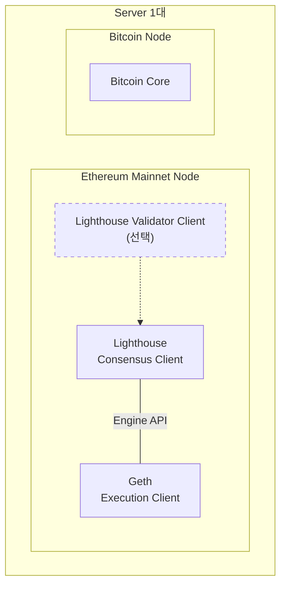

## Client, Node, Server

- **Client**: Protocol 규칙을 Code로 구현한 Software. Binary나 Source Code로 배포한다.
    - 관리: 설치, Version Update, Hard Fork(규칙이 바뀌는 Network Upgrade) 대응.

- **Node**: Client를 특정 Network 설정과 Data로 실행해 다른 Node와 연결된 실행 단위.
    - 관리: Sync(동기화, 최신 Block까지 따라잡는 과정) 진행 상황, Peer(직접 연결된 다른 Node) 연결, RPC(Remote Procedure Call, 외부 Program의 조회와 전송 요청 Interface) 응답 감시.

- **Server**: Node를 실행하는 Computer. 한 Server에서 여러 Node를 실행할 수 있다.
    - 관리: CPU(Central Processing Unit), Memory, Disk, Network 자원.

- 장애는 Node 단위로 드러나지만 원인은 셋 중 어디에도 있을 수 있다. Client Bug, 잘못된 설정, Server 자원 부족이 모두 Sync 지연으로 나타난다.
- 이 문서는 Ethereum과 Bitcoin 기준이다. 수치와 Flag는 2026년 11월에 확인한 공식 문서 기준이며 시간이 지나면 바뀐다.

 

## Client

### What is a Client?

Client는 Blockchain Protocol의 규칙을 Code로 구현한 Software다. 
Protocol은 문서로 된 명세일 뿐 실행되지 않는다. 명세를 Code로 옮겨 Block을 검증하고 Peer와 통신하고 Data를 저장하는 Software가 Client다. [Ethereum.org](https://ethereum.org/en/developers/docs/nodes-and-clients/)도 Client를 Protocol 규칙에 따라 Data를 검증하는 Ethereum 구현체로 정의한다.

### Why Client Diversity Matters

같은 Protocol을 여러 팀이 따로 구현할 수 있다. 구현이 여럿 있고 Node들이 그 구현들에 고르게 나뉘어 있는 상태를 Client Diversity(클라이언트 다양성)라고 한다. 한 Client에 Bug가 생겨도 그 Client를 쓰는 Node만 영향을 받는다. 이 효과는 구현의 개수가 아니라 점유율 분포에서 나온다. Ethereum의 PoS(Proof of Stake, 지분증명) 합의를 예로 들면 이유가 분명해진다.

**Ethereum의 Finality가 정해지는 방식**

- Validator(검증자): ETH(Ether, Ethereum의 기본 화폐)를 예치하고 Block 제안과 투표로 합의에 참여하는 주체.

- Checkpoint(체크포인트): Epoch(에포크, PoS 합의의 시간 단위)마다 첫 Block.

- Justified(정당화): 전체 예치 Stake(지분)의 2/3 이상이 어떤 Checkpoint에 투표한 상태.

- Finalized(완결): Justified Checkpoint의 바로 다음 Epoch Checkpoint도 Justified 된 상태. 이때 앞의 Checkpoint는 되돌려지지 않는다고 확정된다. 이 성질이 Finality(완결성)다.

**점유율이 문제가 되는 이유**

두 단계 모두 Stake 2/3 이상의 투표가 필요하다.

- 한 Consensus Client 점유율 > 1/3: 그 Client에 Bug가 생기면 나머지만으로 2/3를 못 채워 Finality가 멈출 수 있다.
- 한 Consensus Client 점유율 ≥ 2/3: 그 Client만으로 2/3를 채우므로 Bug가 있는 Chain이 완결될 수 있다.

**목표**

- 어떤 Client도 33% 미만. [Ethereum.org](https://ethereum.org/developers/docs/nodes-and-clients/client-diversity/)는 Consensus Client와 Execution Client 모두에 이 기준을 제시한다.
- 같은 문서는 "Node의 33%"로 표현하지만, 투표의 무게는 Node 수가 아니라 예치 Stake이므로 정확한 기준은 Stake 비중이다.
- 현재 점유율은 [Clientdiversity.org](https://clientdiversity.org/)에서 확인한다.

### Clients by Implementation

| Chain | Client | 실행 파일 또는 구성 |
| --- | --- | --- |
| Bitcoin | [Bitcoin Core](https://bitcoincore.org/) | `bitcoind` |
| Ethereum | Execution Client: [Geth](https://geth.ethereum.org/), [Nethermind](https://www.nethermind.io/nethermind-client), [Besu](https://besu.hyperledger.org/), [Erigon](https://github.com/erigontech/erigon), [Reth](https://reth.rs/), [ethrex](https://ethrex.xyz/) / Consensus Client: [Lighthouse](https://lighthouse.sigmaprime.io/), [Prysm](https://prysm.offchainlabs.com/docs/), [Teku](https://consensys.io/teku), [Nimbus](https://nimbus.team/), [Lodestar](https://github.com/ChainSafe/lodestar), [Grandine](https://docs.grandine.io/) | Execution Client 1개와 Consensus Client 1개를 연결 |
| BSC(BNB Smart Chain) | [BSC Geth](https://github.com/bnb-chain/bsc), [BSC Erigon](https://github.com/node-real/bsc-erigon) | Geth 기반. Archive Node는 BSC Erigon 안내 |
| Base | [`base-reth-node`, `base-consensus`](https://github.com/base/base) | Execution과 Consensus 두 Client |
| Solana | [Agave](https://github.com/anza-xyz/agave) 등 | `agave-validator` |
| Aptos | [Aptos Core](https://github.com/aptos-labs/aptos-core) | `aptos-node` |
| Sui | [Sui](https://github.com/MystenLabs/sui) | `sui-node` |
| TRON | [java-tron](https://github.com/tronprotocol/java-tron) | `FullNode.jar` |
| XRP Ledger | [`xrpld`](https://github.com/XRPLF/rippled)(이전 이름 `rippled`), [Clio](https://github.com/XRPLF/clio) | `xrpld`는 P2P(Peer-to-Peer) Mode Server, Clio는 API(Application Programming Interface) 전용 Server |

**참고**

- Ethereum 목록은 [Nodes and Clients 문서](https://ethereum.org/developers/docs/nodes-and-clients/) 기준이다. ethrex는 이 문서에는 있지만 [Client Diversity 문서](https://ethereum.org/developers/docs/nodes-and-clients/client-diversity/)의 점유율 집계에는 아직 없다.

- XRP Ledger의 `rippled`는 [Version 3.2.0](https://xrpl.org/ja/blog/2026/xrpld-3.2.0.md)(2026년 6월)에서 `xrpld`로 이름이 바뀌었다.

- Aptos 실행 파일은 [Aptos PFN(Public Full Node) 문서](https://aptos.dev/en/network/nodes/full-node/fullnode-source-code-or-docker), TRON 실행 파일은 [TRON 배포 문서](https://developers.tron.network/docs/deploy-the-fullnode-or-supernode) 기준이다.

### Clients by Role: Ethereum

Bitcoin Core는 Program 하나가 Node의 일을 모두 맡는다. Ethereum은 2022년 9월 The Merge(머지)로 PoS로 전환한 뒤부터 Node 하나에 Client 2개가 필수다. [Node Architecture 문서](https://ethereum.org/en/developers/docs/nodes-and-clients/node-architecture/)

**State**

- 특정 Block 시점의 전체 장부.

- Ethereum: 계정별 잔액, Nonce(논스, 그 계정이 보낸 Transaction 수), Contract Code와 Contract Storage.

- Bitcoin: UTXO(Unspent Transaction Output, 아직 쓰이지 않은 Transaction 출력)의 집합.

**Client의 역할**

- **Execution Client(실행 클라이언트)**: Transaction을 EVM(Ethereum Virtual Machine)에서 실행하고, 최신 State를 보관하며, 외부에 JSON-RPC(JavaScript Object Notation RPC)를 제공한다. 필수.

- **Consensus Client(합의 클라이언트)**: PoS 합의 Algorithm을 구현하고 Block을 전파한다. Engine API로 Execution Client를 구동한다. 필수.

- Validator Client(검증자 클라이언트): Staking을 할 때만 Consensus Client에 추가한다. Validator 서명 Key로 Block 제안과 Attestation(어테스테이션, Block에 대한 투표)을 처리한다. 선택.

**실행 방식**

- 두 필수 Client는 각자의 P2P Network를 쓴다. Execution Client는 Transaction을, Consensus Client는 Block을 전파한다.
- [Lighthouse](https://lighthouse-book.sigmaprime.io/)는 Consensus Client와 Validator Client를 별도 Process로 실행한다. [Teku](https://docs.teku.consensys.io/)와 [Nimbus](https://nimbus.guide/)는 한 Process로 함께 실행할 수 있다.

### Clients by Verification Scope: Full Client and Light Client

**용어**

- Block Header: Block의 요약 정보. 이전 Block의 Hash와 Block 안 Data를 요약한 값이 들어 있다.

- Hash: Data를 고정 길이 값으로 바꾼 결과. 원래 Data가 조금만 달라져도 값이 달라진다.

- Merkle Root: 많은 Data를 Hash Tree로 묶어 하나의 Hash로 요약한 값.

- Merkle Proof: 어떤 Data가 그 Tree에 포함되는지를 Tree의 일부 경로만으로 증명하는 것.

- Bitcoin Header에는 Transaction의 Merkle Root가, Ethereum Header에는 State 전체를 요약한 State Root(상태 루트)도 들어 있다.

**두 종류**

- Full Client: 받은 Block을 모두 직접 실행해 검증한다.

- Light Client: Block Header와 Merkle Proof만 확인한다. Light Client를 실행하는 Node가 Light Node다.

- Ethereum의 Light Client는 Full Client와 별도 구현인 경우가 많다. [Ethereum.org](https://ethereum.org/developers/docs/nodes-and-clients/light-clients/)는 Lodestar, Helios, Nimbus의 Light Client와 Geth Light Mode를 예로 든다.

 

## Node

### What is a Node?

Node는 Client를 특정 Network 설정과 Data Directory로 실행해 다른 Node와 연결된 Instance다. [Ethereum.org](https://ethereum.org/en/developers/docs/nodes-and-clients/)도 같은 뜻으로 정의한다. 같은 Client도 Mainnet 설정이면 Mainnet Node, Testnet 설정이면 Testnet Node가 된다.

**Node가 하는 일** (범위는 종류에 따라 다르다)

- P2P 연결: 중앙 Server 없이 다른 Node와 직접 Data를 주고받는다.
- 수신과 검증: Block과 Transaction이 Protocol 규칙에 맞는지 확인하고 다른 Node에 전달한다.
- 저장: Block과 State를 Disk에 보관한다.
- RPC 응답: `bitcoind`는 JSON-RPC를 기본으로 켜되 Localhost(같은 Computer 안)만 받는다. Geth는 HTTP(HyperText Transfer Protocol) JSON-RPC를 `--http`로 따로 켜야 한다. 외부 공개는 어느 쪽이든 운영자 설정이 필요하다.

### Node Types

Node 종류는 서로 독립인 두 Criterion(기준)으로 나눈다.

- Criterion 1: 무엇을 얼마나 저장하고 어디까지 스스로 검증하는가 → Full, Archive, Pruned, Light.

- Criterion 2: Network에서 어떤 역할을 맡는가 → Validator, Mining, RPC.

- Node 하나는 Criterion 1에서 하나에 해당하고, Criterion 2의 역할은 없거나 여러 개일 수 있다. 예를 들어 Archive Node이면서 RPC Node일 수 있다.

- 둘을 섞으면 "Validator Node는 무엇을 저장하는가"에 답할 수 없다. 저장 범위는 Criterion 1에서 정해지기 때문이다.

### Criterion 1. 저장 Data와 검증 수준

#### Full Node

수신하는 Block을 합의 규칙에 따라 스스로 검증하는 Node다. 기준은 저장량이 아니라 **직접 검증 여부**다.

**검증**

- Block이 합의 규칙을 지키는지 확인하고, Transaction을 직접 실행해 State를 갱신한다.
- Ethereum은 실행 결과 State가 Header의 State Root와 일치하는지도 확인한다.

**저장**

- Ethereum State: 최근 시점만 보관한다. 보통 최근 128 Block이다. 그보다 오래된 State는 삭제하고 필요하면 보관한 Block을 다시 실행해 만든다. [Ethereum.org](https://ethereum.org/en/developers/docs/nodes-and-clients/)

- Ethereum Block 이력: 2025년 7월 8일부터 모든 Execution Client가 [EIP(Ethereum Improvement Proposal)-4444](https://eips.ethereum.org/EIPS/eip-4444)에 따른 Partial History Expiry(부분 이력 만료)를 지원한다. The Merge 이전 Block Body(블록 본문, Transaction 목록)와 Receipt(영수증, 실행 결과 기록)를 삭제할 수 있고, Mainnet 기준 300에서 500GB(Gigabyte)가 줄어든다. Header는 유지하므로 Genesis Block(제네시스 블록, 첫 Block)부터 Chain을 확인할 수 있다. Nethermind는 1.32.2부터 새 Sync에 기본 적용한다. [EF(Ethereum Foundation) Blog](https://blog.ethereum.org/2025/07/08/partial-history-exp)

- Bitcoin Core: 기본 설정(`-prune=0`)은 모든 Block을 보관한다.

**최초 Sync의 예외** (Sync 후 새 Block은 모두 직접 검증한다)

- Ethereum Execution Client: Full Sync는 Genesis부터 모든 Block을 실행한다. Snap Sync는 최근 State를 다른 Node에서 받아 재구성한 뒤 새 Block부터 검증한다. Geth 기본값은 Snap Sync다. [Geth Sync Mode](https://geth.ethereum.org/docs/fundamentals/sync-modes)

- Ethereum Consensus Client: Checkpoint Sync(Weak Subjectivity Sync)로 신뢰하는 출처의 최근 Checkpoint부터 시작한다.

- Bitcoin Core: 기본으로 켜진 `assumevalid`는 [Source Code에 지정된 Block](https://github.com/bitcoin/bitcoin/blob/master/src/kernel/chainparams.cpp) 이전의 [Script(서명) 검증만 생략](https://mirror.b10c.me/bitcoin-bitcoin/27050/)한다. `-assumevalid=0`으로 끄면 전부 검증한다.

#### Archive Node

Full Node Data에 더해 모든 과거 Block 시점의 State를 보관하는 Node다. 검증은 Full Node와 같다.

**용도와 성격**

- 과거 시점의 계정 잔액 조회, 과거 Transaction의 Tracing(실행 과정 추적). Block Explorer, 지갑 Service, Chain 분석에 쓴다.

- Full Node도 재실행으로 과거 State를 만들 수 있지만, 저장된 시점에서 멀수록 계산이 많이 든다.

- 합의에는 최신 State만 필요하므로 Network 동작에 필수는 아니다. [Ethereum.org](https://ethereum.org/developers/docs/nodes-and-clients/archive-nodes/)

**Disk 사용량** (Ethereum Mainnet, Version과 시점에 따라 바뀐다)

- Erigon, Reth, Geth(Path-Based Archive): 약 2에서 3TB(Terabyte). Besu, Nethermind: 12TB 이상. [Ethereum.org](https://ethereum.org/developers/docs/nodes-and-clients/archive-nodes/)

- Geth Hash-Based Archive(기존 방식): 20TB 초과 가능. v1.16.0의 Path-Based Archive: 약 2TB, 과거 Trie Node(State를 담는 Tree의 Node)까지 보관하면 약 6.5TB. 과거 시점 `eth_getProof`는 v1.17.x부터 `--history.trienode=N` 설정 시 지원한다. [Geth 문서](https://geth.ethereum.org/docs/fundamentals/archive)

**Bitcoin**

- 과거 시점의 UTXO 집합을 보관하는 Archive Mode가 없다. 대신 Block 보관 범위로 구분한다.
- Pruning하지 않는 Node만 [`NODE_NETWORK`](https://github.com/bitcoin/bitcoin/blob/master/src/protocol.h)를 알리고 전체 Block을 제공한다. Bitcoin에서 "Archive"는 전체 Block 보관을 뜻한다.

#### Pruned Node

오래된 Block Body를 삭제하고 Header 전체, 최근 Block, 최신 State를 유지하는 Node다. Pruning(프루닝)은 더 필요 없는 오래된 Data를 지워 저장 공간을 줄이는 것이다. 삭제 전에 검증하므로 검증 수준은 Full Node와 같다.

**Bitcoin Core** ([`validation.h`](https://github.com/bitcoin/bitcoin/blob/master/src/validation.h), [`init.cpp`](https://github.com/bitcoin/bitcoin/blob/master/src/init.cpp))

- `-prune=<n>`: Block File을 n MiB(Mebibyte, 2^20 Byte) 아래로 유지한다. 최솟값은 550MiB다. 기준은 Block 수가 아니라 용량이다.
- 최근 288 Block이 든 File은 삭제하지 않고, 다른 Node에 `NODE_NETWORK_LIMITED`([BIP(Bitcoin Improvement Proposal)-159](https://github.com/bitcoin/bips/blob/master/bip-0159.mediawiki))를 알려 최근 288 Block(약 2일분)만 제공한다.
- `-txindex`와 함께 쓸 수 없다. Pruning을 끄려면 전체를 다시 내려받아야 한다.

**Ethereum**

- 공식 분류(Light, Full, Archive)에 Pruned Node는 없다. Archive가 아닌 Sync는 모두 오래된 State가 Pruning된다.
- Partial History Expiry를 켠 Node를 [EF Blog](https://blog.ethereum.org/2025/07/08/partial-history-exp)는 Pruned Node라고 부른다. 따라서 "Pruning"이 State 정리인지 The Merge 이전 이력 삭제인지 확인해야 한다. [Geth History Pruning](https://geth.ethereum.org/docs/fundamentals/historypruning)

#### Light Node

Header 수준의 Data만 받고 나머지는 Full Node에 요청하는 Node다. 받은 Data는 Header의 Root Hash와 대조해 스스로 확인한다. Full Node에 맡기는 것은 Data이고 검증이 아니다.

**받는 Data**

- Bitcoin SPV(Simplified Payment Verification): Genesis부터 전체 Header Chain.
- Ethereum: 모든 Header를 받지 않는다. 아래 Update만 받아 최근 Header와 Sync Committee 정보만 유지한다.

**확인하는 것과 못하는 것**

- 확인: Header 유효성, 받은 Data의 Merkle Proof(예: Transaction 포함 여부, 계정 잔액).
- 확인 불가: State 전이의 정당성. Transaction을 실행하지 않기 때문이다.

**Header 유효성의 근거**

- Bitcoin: PoW(Proof of Work, 작업증명)가 가장 많이 쌓인 Header Chain을 따른다. [White Paper 8장](https://bitcoin.org/bitcoin.pdf)은 정직한 Node가 다수일 때만 믿을 수 있다고 적는다. 관련 Data만 받는 방식으로 [BIP-37](https://github.com/bitcoin/bips/blob/master/bip-0037.mediawiki)(Bloom Filter)과 [BIP-157](https://github.com/bitcoin/bips/blob/master/bip-0157.mediawiki)/[158](https://github.com/bitcoin/bips/blob/master/bip-0158.mediawiki)(Compact Block Filter)이 있고, Bitcoin Core는 응답 기능을 둘 다 기본으로 꺼 둔다([`net_processing.h`](https://github.com/bitcoin/bitcoin/blob/master/src/net_processing.h)).

- Ethereum: 2021년 10월 Altair에서 Sync Committee(동기화 위원회)를 도입했다. 256 Epoch(약 1.1일)마다 무작위로 뽑힌 Validator 512명이 최근 Header에 서명한다. [Altair 명세](https://ethereum.github.io/consensus-specs/specs/altair/light-client/sync-protocol) 기준으로 Finalized Header 갱신에는 위원회 2/3 이상의 서명이 필요하고, Optimistic Header(최신 Header)는 최근 최대 참여 수의 절반을 넘으면 갱신되며, Update 유효성 검사의 최소 서명자 수는 1이다.

**한계**

- Data는 Full Node에, Header 신뢰는 채굴력 또는 Validator 다수의 정직함에 의존한다.
- 합의에 참여하지 않으며 Validator가 될 수 없다.
- Ethereum.org 작성 시점 기준 Production 수준의 Ethereum Light Client는 없다. [Ethereum.org](https://ethereum.org/developers/docs/nodes-and-clients/light-clients/)

### Criterion 2. Network 내 역할

#### Validator Node

PoS Chain에서 Block 제안과 투표로 합의에 참여하는 Node다. Stake를 예치한다.

**Ethereum**

- 활성화에 최소 32 ETH가 필요하다.
- 2025년 5월 [Pectra](https://ethereum.org/en/roadmap/pectra/)의 [EIP-7251](https://eips.ethereum.org/EIPS/eip-7251)로 최대 유효 잔액(Max Effective Balance)이 2048 ETH로 올라갔다. 이 한도는 0x02(Compounding) Withdrawal Credential을 가진 Validator에만 적용된다. 0x01 Credential은 32 ETH 상한이 유지되고 초과분은 자동 인출된다.
- 구성: Consensus Client + Validator Client.
- 처벌: Penalty(패널티)와 Slashing(슬래싱, 예치금 삭감 후 [Validator 집합에서 퇴출](https://ethereum.org/en/developers/docs/consensus-mechanisms/pos/rewards-and-penalties/)). 다른 Chain의 조건은 해당 문서로 확인한다.

**저장 범위**

- Block을 직접 검증해야 하므로 보통 Full Node다. Light Node는 불가하다.

#### Mining Node

PoW Chain에서 후보 Block을 만들고 Nonce를 탐색해 Block을 생성하는 Node다. 여기서 Nonce는 Header Hash가 난이도 조건을 만족할 때까지 바꿔 넣는 값이다. Ethereum 계정의 Nonce와는 이름만 같다.

- 저장 범위: 최신 State와 Mempool(멤풀, 대기 중인 Transaction 모음)이 필요하므로 Full Node다. Bitcoin Core는 [`getblocktemplate`](https://github.com/bitcoin/bitcoin/blob/master/src/rpc/mining.cpp)로 후보 Block Template을 준다.

- Mining Pool(마이닝 풀): Stratum V1에서는 Pool 운영자의 Node가 Template을 만들고 개별 채굴기는 Hash 연산만 한다. 이 채굴기는 Client를 실행하지 않으므로 Node가 아닐 수 있다. [Stratum V2 Job Declaration](https://stratumprotocol.org/docs)을 쓰면 채굴기 운영자가 자기 Node로 Template을 만들 수 있다.

- Ethereum은 The Merge 이후 Mining Node가 없다.

#### RPC Node

외부 Application(지갑, DApp(Decentralized Application, 탈중앙화 애플리케이션), Backend Server)의 조회와 Transaction 전송 요청을 처리하는 Node다.

- 저장 범위: 최신 State만 조회하면 Full Node, 과거 State를 조회하면 Archive Node.

- Ethereum: Partial History Expiry를 켠 Node는 The Merge 이전 Body와 Receipt 요청에 응답하지 않을 수 있다. [EIP-4444 구현 계획](https://hackmd.io/Dobc38YVQ1qmbbyI6LcFqA)은 이 Data에 대한 응답 의무를 없앤다.

- Bitcoin: [`getrawtransaction`](https://github.com/bitcoin/bitcoin/blob/master/src/rpc/rawtransaction.cpp)은 `-txindex`가 없으면 Mempool의 Transaction만 찾는다. 임의의 과거 Transaction을 ID(Identifier)만으로 조회하려면 `-txindex`가 필요하고, `-txindex`는 Pruning과 병용할 수 없다.

- Load Balancer 구성은 Node 속성이 아니라 운영 Infrastructure다.

### What Determines a Node Type?

**실행 Option**

- 대부분 별도 Software가 아니라 같은 Client의 Option으로 정해진다. Bitcoin Core `-prune`, Geth `--gcmode archive`(Path-Based는 `--history.state=0`과 함께), Solana Agave `--no-voting`, TRON `FullNode.jar --witness`.

**되돌릴 수 없는 것**

- 보관 범위를 줄였다 늘려도 지운 Data는 돌아오지 않는다. Bitcoin Core는 전체 재Sync가 필요하고, [Geth 문서](https://geth.ethereum.org/docs/fundamentals/archive)도 지운 과거 State는 복구할 수 없다고 적는다. 보관 범위는 Sync 전에 정한다.

**예외**

- Light Client는 별도 구현인 경우가 많다.
- Archive Node는 Client마다 Disk 차이가 커서 Client를 따로 고르기도 한다. [Ethereum.org](https://ethereum.org/developers/docs/nodes-and-clients/archive-nodes/)는 Erigon을 가장 실용적이라고 본다.

### Nodes by Chain

| Chain | 공식 문서의 Node 종류 | 두 Criterion으로 보면 |
| --- | --- | --- |
| Bitcoin | Full Node, Pruned Node(`-prune`) | Criterion 1 구분. Mining은 역할로 더해짐 |
| Ethereum | Full, Archive, Light | Criterion 1 구분. Validator는 Validator Client를 더한 역할 |
| BSC | Fast, Full, Archive, Validator | Fast Node는 Full Node에서 State Root 검증을 끈 형태 |
| Base | 별도 분류 없음 | Ethereum처럼 Execution과 Consensus 두 Client |
| Solana | Validator, RPC Node | 같은 Software. 투표하면 Validator, `--no-voting`이면 RPC Node |
| Aptos | Validator Node, VFN(Validator Full Node), PFN | VFN과 PFN은 기능이 같고 Sync 대상만 다름 |
| Sui | Validator, Full Node | Full Node는 보관 기간 밖 이력 삭제. 전체 이력은 Archival Service |
| TRON | Fullnode, Lite Fullnode | Lite는 저장 축소. SR(Super Representative)은 Fullnode에 Block 생산 역할 추가 |
| XRP Ledger | P2P Mode Server(Stock Server), Validator, API Server, Hub Server | 하나의 P2P Mode Server에 역할을 설정으로 추가 |

**Chain별 보충**

- BSC: Fast Node는 `--tries-verify-mode none`으로 [State Root를 검증하지 않아](https://docs.bnbchain.org/docs/BSC-separate-node/) Peer와 State가 어긋날 가능성이 아주 작게 남는다. [한 번 Fast로 실행하면](https://docs.bnbchain.org/docs/BSC-fast-node) Full로 되돌릴 수 없다. [Archive Node](https://docs.bnbchain.org/bnb-smart-chain/developers/node_operators/archive_node/)는 `--gcmode archive`로 정의되며 Mainnet은 BSC Erigon으로 안내한다.

- Base: [`base-consensus`](https://docs.base.org/guides/run-a-base-node)는 Sequencer(시퀀서, L2(Layer 2)에서 Transaction 순서를 정하는 주체)가 전파한 Block을 먼저 받고 이후 L1(Layer 1)에 게시된 Data로 도출한다. [`base/node`](https://github.com/base/node)는 2026년 9월 8일 보관 처리되었고 현재는 [`base/base`](https://github.com/base/base)다.

- Solana: [RPC Node](https://docs.anza.xyz/operations/setup-an-rpc-node)는 투표 계정이 필요 없다. [Alpenglow](https://solana.com/upgrades/alpenglow)가 2026년 10월 21일 Epoch 1064에 Mainnet에서 활성화되어 투표가 Transaction이 아니게 되었다. TowerBFT 시절의 투표 수수료(Epoch당 약 1 SOL)는 없어졌고, 대신 VAT(Validator Admission Ticket, SIMD(Solana Improvement Document)-0357)가 투표하는 Validator마다 Epoch당 0.8 SOL을 Vote Account에서 거둬 소각한다. 잔액이 부족하면 다음 Epoch에 투표와 Block 생산을 못 한다. Block 안 Transaction 수를 세던 지표는 기준을 다시 잡아야 한다.

- Aptos: [Validator](https://aptos.dev/network/blockchain/validator-nodes)는 최소 Stake를 예치한다. [VFN](https://aptos.dev/network/nodes)은 Validator 운영자만 운영하며 Validator에서 Sync하고, [PFN](https://aptos.dev/concepts/fullnodes)은 누구나 운영하며 다른 VFN이나 PFN에서 Sync한다.

- Sui: [Full Node](https://docs.sui.io/build/fullnode)는 Validator가 서명한 Checkpoint를 확인하고 Transaction을 재실행한다. Pruning 후 가장 오래된 지점이 Serving Floor이고 그 이전은 [Archival Service](https://docs.sui.io/develop/accessing-data/archival-store/)에 요청한다. 범위 밖 오류 이름이 문서마다 `OutOfRange`와 `NOT_FOUND`로 다르므로 실제 API로 확인한다.

- TRON: [Lite Fullnode](https://developers.tron.network/docs/nodes-and-clients)는 최신 State와 최근 65,536 Block을 담은 Snapshot에서 시작하고 과거 조회 API는 기본으로 꺼져 있다. [SR Node](https://developers.tron.network/docs/deploy-the-fullnode-or-supernode)는 Fullnode에 `--witness`와 서명 Key를 더한 것이고 Block 생산은 [투표 상위 27개 SR](https://developers.tron.network/docs/super-representatives)이 맡는다. SolidityNode는 보조 Mode(`--solidity`)다.

- XRP Ledger: [Stock Server](https://xrpl.org/docs/concepts/networks-and-servers/xrpld-server-modes)는 설정을 거의 바꾸지 않은 P2P Mode Server다. Validator는 [별도 설정](https://xrpl.org/docs/infrastructure/configuration/server-modes/run-xrpld-as-a-validator)이 필요하다. 전체 이력을 보관하면 Full History Server라고 부른다. [Clio](https://xrpl.org/xrpl-servers.html)는 API 전용이다.

**정리**

- Solana, Aptos, Sui는 역할 중심으로 나눈다. BSC, TRON은 저장과 검증 범위 중심이다. XRP Ledger는 설정으로 역할을 더한다. Ethereum, Base는 Node 하나가 두 Client다.

 

## Example: Server 1대, Node 2개, Client 3개

Ethereum Mainnet Node(Geth + Lighthouse)와 Bitcoin Node(Bitcoin Core)를 한 Server에서 실행한다. Validator Client를 더하면 Client는 4개다.

**관리 대상**

- Geth나 Lighthouse Version Update: Client 작업. Hard Fork 때 둘 다 확인한다.
- Ethereum Node가 최신 Block을 못 따라감: Node 증상. 원인은 Client Bug, 설정, Server 자원 어디든 가능하다.
- Disk 부족: 두 Node가 함께 영향을 받는 Server 문제.

**Geth 설정과 Node 종류** (v1.16.0 이상)

| 설정 | Criterion 1 | Criterion 2 |
| --- | --- | --- |
| 기본 | Full Node(Snap Sync) | 없음 |
| `--history.chain postmerge` | Full Node, The Merge 이전 Body와 Receipt 미보관 | 없음 |
| `--syncmode full --gcmode archive --history.state=0` | Archive Node(Path-Based) | 없음 |
| `--http` | 변화 없음 | RPC Node |
| Lighthouse + Validator Client + 32 ETH | 변화 없음 | Validator Node |

- `--history.state=0`은 모든 과거 State 유지. 미지정 시 기본 90,000 Block. `--gcmode archive`는 State Index를 켠다. Full Sync를 먼저 끝낸 뒤 켜는 것을 권장한다. [Geth Archive 문서](https://geth.ethereum.org/docs/fundamentals/archive)
- `--http`만 켜면 Localhost만 받는다. 외부 공개는 `--http.addr`, Domain 접속은 `--http.vhosts`도 설정한다.

**Bitcoin Core 설정과 Node 종류**

| 설정 | 결과 |
| --- | --- |
| 기본 | Full Node. `NODE_NETWORK` 알림, 과거 Block 제공 |
| `-prune=550` | Pruned Node. 최근 288 Block만 제공, `-txindex` 불가 |
| `-rpcbind` + `-rpcallowip` | 외부 RPC 수신 → RPC Node 역할 추가. [`-rpcbind`는 `-rpcallowip` 없이는 무시된다](https://github.com/bitcoin/bitcoin/blob/master/src/init.cpp) |

 

## Summary

- Client는 Software, Node는 Client를 설정과 Data로 실행한 단위, Server는 Computer다. Update는 Client, Sync와 감시는 Node, 자원은 Server 단위로 다룬다.
- Client Diversity의 효과는 구현 개수가 아니라 점유율이다. Ethereum은 Justification과 Finalization 모두 Stake 2/3가 필요해 33%와 2/3가 기준이다.
- Node 종류는 Criterion 1(Full, Archive, Pruned, Light)과 Criterion 2(Validator, Mining, RPC)로 정해지고 둘은 독립이다. 대부분 실행 Option으로 정해지며 지운 Data는 돌아오지 않는다.
- Full Node의 기준은 직접 검증이다. Archive와 Pruned는 저장 범위만 다르다. Light는 Header와 Proof만 확인하고 외부에 의존한다.
- 같은 용어도 Chain마다 뜻이 다르다. Archive는 Ethereum에서 과거 State 보관이고 Bitcoin에는 없다. Pruned는 Bitcoin에서 오래된 Block 삭제이고 Ethereum 공식 분류에는 없다.
- Validator 비용도 다르다. Ethereum은 0x02 Credential에서만 2048 ETH, Solana는 Alpenglow 이후 Epoch당 0.8 SOL의 VAT다.