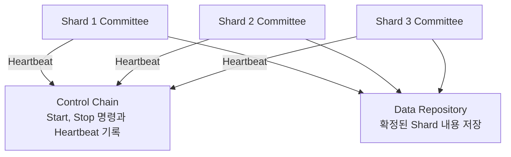
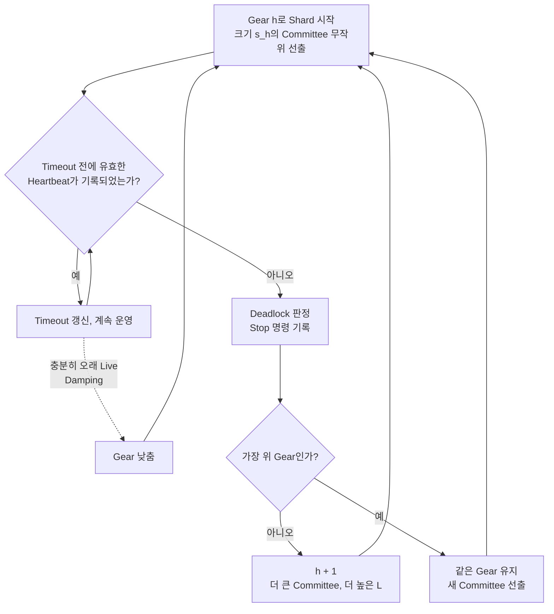

### Paper Information

| Item | Details |
| --- | --- |
| Title | GearBox: Optimal-size Shard Committees by Leveraging the Safety-Liveness Dichotomy |
| Authors | Bernardo David, Bernardo Magri, Christian Matt, Jesper Buus Nielsen, Daniel Tschudi |
| Venue | 2022 ACM(Association for Computing Machinery) SIGSAC(Special Interest Group on Security, Audit and Control) Conference on Computer and Communications Security(ACM CCS 2022), November 7-11, 2022 in Los Angeles, California, 683-696 |
| Link | [Conference Version](https://doi.org/10.1145/3548606.3559375), [Extended Version](https://eprint.iacr.org/2021/211) |

---

## Sharding

### What is Sharding?

일반적인 Blockchain(블록체인)에서는 네트워크의 모든 Node(노드)가 모든 Transaction을 받아 검증하고 저장한다. 따라서 Node가 늘어나도 처리량은 늘지 않으며, Bitcoin 같은 공개 Blockchain의 낮은 처리량은 대규모 사용의 큰 걸림돌이다.

**Sharding(샤딩)**은 이 문제를 병렬화로 해결하려는 방식이다. Node를 여러 작은 그룹으로 나누고, 각 그룹이 전체 작업의 일부를 맡아 별도의 가벼운 Ledger(원장, Transaction 기록)를 운영한다.

- **Shard(샤드)**: 전체 Ledger를 나눠 맡는 작은 Ledger. 각 Shard는 자체 Consensus(합의)를 실행한다.

- **Committee(위원회)**: 하나의 Shard를 운영하는 Node 집합

- **Shard 크기와 효율**: Committee가 작을수록 병렬로 운영할 수 있는 Shard가 많아지고, Shard 내부 Consensus의 통신 부담도 줄어든다.

#### Committee Selection

공격자가 통제하는 Node가 특정 Shard에 몰리지 않도록, Committee는 전체 Node 중에서 무작위로 선출한다.

- **Corrupt Node(악의적 노드)**: 공격자가 통제하며 Protocol을 따르지 않고 임의로 행동할 수 있는 Node(Byzantine Node). 나머지는 Honest Node(정직한 노드)다.

- **Corruption Ratio(악의적 노드 비율)**: 전체 Node 또는 Committee에서 Corrupt Node가 차지하는 비율

- **Randomness Beacon(무작위값 비콘)**: 모든 Node에게 같은 무작위값을 제공하고, 그 값이 올바른지 검증할 수 있게 하는 장치. 모든 Node가 같은 무작위값으로 Committee를 뽑으므로 선출 결과에 합의할 수 있고, 외부에서도 결과를 검증할 수 있다.

실제 Blockchain에서는 Corruption Ratio를 Node 수가 아니라 Stake(지분)나 연산력 같은 자원의 비율로 따진다. 논문은 설명을 단순화하기 위해 Node 수 기준으로 다루며, 자원 비율에 맞춰 Node를 가상의 Node들로 대응시키는 기존 기법을 쓰면 같은 결과를 적용할 수 있다고 설명한다.

### Shard Consensus

Shard 안에서는 보통 BFT(Byzantine Fault Tolerance, 비잔틴 장애 허용) Consensus를 실행한다. BFT Consensus는 일부 Node가 Corrupt Node여도 Honest Node들이 같은 결과에 합의하도록 하는 Protocol이다. GearBox도 이 방식을 기준으로 한다.

#### Safety와 Liveness

Blockchain의 보안은 두 성질로 나눈다.

- **Safety(안전성)**: Honest Node들이 출력하는 메시지 순서가 서로 일치한다. 즉, 서로 다른 두 기록이 함께 확정되지 않는다.

- **Liveness(활성)**: 새 메시지가 결국 모든 Honest Node의 Ledger에 기록된다. 즉, Ledger가 멈추지 않고 진행한다.

- **Safety Threshold(안전성 임계값) S, Liveness Threshold(활성 임계값) L**: 각각 Safety와 Liveness가 보장되는 최대 Corruption Ratio

#### Network Model

- **Synchronous(동기)**: 메시지 전달 지연의 상한 $\Delta$가 있고, 모든 Node가 그 값을 안다.

- **Partially Synchronous(부분 동기)**: 지연의 상한 $\Delta$는 있지만 Node들은 그 값을 모른다. 논문은 이렇게 정의하며, GearBox는 주로 이 모델을 다룬다.

#### Quorum 기반 BFT Consensus

PBFT(Practical Byzantine Fault Tolerance), HotStuff, Tendermint 같은 Leader 기반 BFT Consensus는 Quorum(정족수)으로 Block을 확정한다.

- Committee 크기가 s이고 Corrupt Node가 최대 f개라고 하자.

- Leader(Block을 제안하는 Node)가 Block을 제안하고, Node들이 Block에 서명한다.

- Block은 q개 이상의 서명을 모으면 확정(Final)된다.

q는 두 조건을 함께 만족해야 한다.

1. **Liveness 조건**: Corrupt Node f개가 서명하지 않아도 진행해야 하므로 $q \le s - f$

2. **Safety 조건**: 같은 높이에서 서로 다른 두 Block이 각각 q개 서명을 받았다면, 두 서명 집합은 최소 $2q - s$개 Node가 겹친다. Honest Node는 같은 높이의 서로 다른 두 Block에 서명하지 않으므로, 겹친 Node 중 Honest Node가 한 명이라도 있으면 두 Block이 함께 확정될 수 없다. 따라서 $2q - s > f$

$q = s - f$로 두면 $2(s - f) - s > f$, 즉 $s > 3f$다. Committee의 Corruption Ratio가 1/3 미만이어야 하고, 이것이 Partially Synchronous BFT Consensus의 표준 설정인 $s = 3f + 1$, $q = 2f + 1$이다.

- 예: $s = 4$, $f = 1$, $q = 3$. 서명 3개짜리 두 집합은 최소 2개 Node가 겹치고, Corrupt Node는 최대 1개이므로 겹친 Node 중 적어도 한 명은 Honest Node다.

여기서 중요한 점은 **하나의 f가 Liveness와 Safety를 함께 결정한다**는 것이다. 즉 $L = S$이고, Partially Synchronous 환경에서는 $L = S < 1/3$이다.

### How Sharding Works

- 예시: 전체 Node 10,000개 중 최대 30%가 Corrupt Node인 상황

1. **Committee 선출**

    Randomness Beacon의 무작위값으로 Shard마다 s개 Node를 무작위로 뽑는다.

2. **Shard 운영**

    각 Committee는 자기 Shard에서 BFT Consensus를 실행해 Transaction을 처리한다.

3. **보안 조건**

    각 Committee의 Corruption Ratio가 1/3 미만이어야 해당 Shard의 Safety와 Liveness가 모두 보장된다.

전체 비율이 30%여도 무작위로 뽑은 Committee의 비율은 30% 주변에서 흔들린다. 운이 나쁘면 어떤 Committee는 1/3을 넘고, 그 Shard는 Safety를 잃는다.

 

## Shard Size Problem

### Committee가 커야 하는 이유

Shard가 안전하려면, Committee의 Corruption Ratio가 허용치를 넘을 확률이 무시할 수 있을 만큼 작아야 한다. 논문은 이 확률을 $2^{-60}$ 이하로 잡는다(60-bit Security, 60비트 보안).

전체 Node n개 중 t개가 Corrupt Node이고 그중에서 s개를 무작위로 뽑을 때, Committee에 Corrupt Node가 t'개보다 많이 들어갈 확률은 Hypergeometric Distribution(초기하 분포)으로 계산한다.

$$
\Pr[\text{FAIL}] = \sum_{i = t' + 1}^{s} \frac{\binom{t}{i}\binom{n - t}{s - i}}{\binom{n}{s}}
$$

- $\binom{n}{s}$: n개 중 s개를 뽑는 전체 경우의 수

- $\binom{t}{i}\binom{n - t}{s - i}$: Corrupt Node i개와 Honest Node $s - i$개를 뽑는 경우의 수

이 확률이 $2^{-60}$ 이하가 되는 가장 작은 s가 최소 Committee 크기다. Committee의 허용 Corruption Ratio를 1/3로 두면 결과는 다음과 같다.

| 전체 Node 수 | 전체 Corruption Ratio | 최소 Committee 크기 |
| --- | --- | --- |
| 10,000 | 30% | 5,886 |
| 2,000 | 30% | 1,716 |
| 2,000 | 20% | 540 |

- 10,000개 Node 중 Shard 하나에 5,886개가 필요하면, Sharding으로 얻는 효율 향상이 거의 없다.

- 필요한 크기는 Security Parameter(보안 수준을 나타내는 값, 여기서는 60)에 거의 선형으로 비례한다. 30-bit Security로 낮춰도 약 3,000개가 필요하다. Committee를 수백 개 수준으로 줄이려면 받아들이기 어려운 수준까지 보안을 낮춰야 한다.

- 전체 비율 30%와 허용치 1/3 사이의 여유가 약 3%p밖에 없으므로, Committee의 비율이 이 좁은 범위를 벗어나지 않으려면 표본이 커야 한다. 반대로 허용 Corruption Ratio를 높이면 필요한 Committee 크기는 급격히 줄어든다.

### 기존 Sharding Protocol

- **Elastico**: 공개 Blockchain을 위한 최초의 Sharding Protocol. Shard당 약 100개 Node의 작은 Committee를 권장했지만, OmniLedger 논문의 분석에 따르면 6 Epoch(Committee를 다시 뽑는 주기) 만에 Shard가 Unsafe해질 확률이 약 97%에 이른다. 작은 Committee로는 사실상 안전하지 않다.

- **OmniLedger**: 전체 Corruption Ratio가 1/4 미만일 때 효율적으로 동작한다. 1/3까지 허용할 수 있지만 성능이 크게 떨어진다.

- **RapidChain**: Synchronous 모델에서 전체 1/3 미만의 Corrupt Node를 허용한다.

이 Protocol들은 최악의 Corruption 상황에서도 Shard의 Safety와 Liveness를 **모두** 보장하려 한다. 그래서 L과 S를 같은 값으로 두어야 하고, Committee 크기가 크게 제한된다.

또한 이 Protocol들은 Composability(결합 가능성), 즉 다른 Protocol과 함께 실행되거나 더 큰 시스템의 구성 요소로 쓰일 때의 보안을 증명하지 않았다. Blockchain은 화폐나 Smart Contract 같은 더 큰 시스템의 구성 요소로 쓰이므로 이 성질이 중요하다.

### Safety와 Liveness의 차이

두 성질이 깨졌을 때의 결과는 다르다.

- **Safety가 깨지면**: 서로 다른 기록이 확정되어 Double Spending(이중 지불) 등이 가능해진다. 이미 확정된 기록끼리 충돌하므로 되돌릴 수 없다.

- **Liveness가 깨지면**: Shard가 멈출 뿐 잘못된 기록이 확정되지는 않는다. 멈춘 것을 감지할 수 있다면 Committee를 바꿔 다시 시작하면 된다.

**⇒ Shard를 작게 만들려면 Committee가 더 높은 Corruption Ratio를 견뎌야 한다. 그러나 L = S로 묶여 있는 한 Partially Synchronous 환경에서 1/3을 넘을 수 없다. 한편 되돌릴 수 없는 것은 Safety 위반이다. 따라서 Safety는 항상 지키고, Liveness는 잃더라도 감지하고 복구하는 구조라면 Committee를 크게 줄일 수 있다.**

 

## Solution: GearBox

**GearBox**는 Shard Consensus의 Safety와 Liveness를 분리해, 현재 Corruption Ratio에 맞는 거의 최적 크기의 Committee로 Shard를 운영하는 Sharding Protocol이다(David et al., 2022).

- Safety Threshold는 높게, Liveness Threshold는 낮게 설정한 작은 Committee로 시작한다. → Shard는 항상 Safe하지만 멈출 수 있다.

- 항상 Safe하고 Live한 별도의 Ledger인 **Control Chain(제어 체인)**이 Shard가 멈췄는지 감시한다.

- 멈춘 Shard는 더 큰 Committee와 더 높은 Liveness Threshold로 다시 시작한다.

- Shard가 Live해질 때까지 이를 반복한다.

| | 기존 Sharding | GearBox |
| --- | --- | --- |
| Threshold 설정 | L = S | L과 S를 분리 |
| 최악의 경우를 보장하는 성질 | Safety와 Liveness | Safety |
| Liveness 실패 | 무시할 수 있는 확률로만 허용 | 허용, Control Chain이 감지해 재시작 |
| Leader 교체 | Shard Consensus 내부 절차 | 없음, Committee 재선출로 대체 |
| Committee 크기 (전체 10,000개, 최대 30%) | 5,886 | 실제 Corruption Ratio에 따라 35에서 1,713 |

### Safety-Liveness Dichotomy

**Shard Safety-Liveness Dichotomy(샤드 안전성-활성 이분법)**는 Shard Consensus가 가질 수 있는 (L, S) 조합의 한계다.

- **Partially Synchronous**: $2L + S < 100\%$

- **Synchronous**: $L + S < 100\%$

L = S로 두면 각각 1/3, 1/2 미만이 된다. 하지만 L을 낮추면 그만큼 S를 높일 수 있다.

앞의 Quorum 계산을 일반화하면 이 관계가 나온다. Liveness를 위해 허용하는 Corrupt Node 수를 $t_L$, Safety를 위해 허용하는 Corrupt Node 수를 $t_S$라 하자.

1. **Liveness 조건**: Corrupt Node $t_L$개가 서명하지 않아도 진행해야 하므로 Quorum $q = s - t_L$

2. **Safety 조건**: 두 Quorum은 최소 $2q - s = s - 2t_L$개 Node가 겹친다. 겹친 Node 중 Honest Node가 있으려면 $t_S < s - 2t_L$

따라서 $t_S = s - 2t_L - 1$로 둘 수 있고, 양변을 s로 나누면 $S + 2L < 100\%$다.

- 예: $s = 100$

    - $t_L = 33$ → $t_S = 33$ (일반적인 BFT Consensus)

    - $t_L = 0$ → $t_S = 99$ (모든 Node가 서명해야 Block이 확정됨. Honest Node가 한 명만 있어도 Safety가 유지되지만, Corrupt Node가 한 명만 있어도 Liveness가 깨질 수 있음)

이 관계는 특정 Protocol의 한계가 아니다. 논문은 Committee 밖의 Node가 Shard에 메시지를 쓰고 읽는 상황에서는 어떤 Shard Consensus도 이 한계를 넘을 수 없음을 증명한다.

- Partially Synchronous 환경에서 Reader(Shard의 상태를 읽는 외부 Node)는 지연이 큰 Honest Node와 응답하지 않는 Corrupt Node를 구별할 수 없다. 따라서 일부 Node에게서 응답을 받지 못한 상태로 결정을 내려야 하고, 응답한 Node 중에도 Corrupt Node가 섞여 있을 수 있다.

- Dolev-Strong Broadcast는 Synchronous 환경에서 L = S = 99%를 달성하지만, Committee 내부의 합의만 보장할 뿐 외부 Node가 합의된 값을 확인할 방법은 없다. Shard는 Committee 밖의 Node에게 Ledger 상태를 납득시켜야 하므로, Dolev-Strong Broadcast는 이 한계의 반례가 되지 않는다.

### 핵심 아이디어

기존 방식은 Committee 하나에 L = S = 1/3을 요구한다. GearBox는 두 Threshold의 역할을 나눈다.

- **Committee 크기는 Safety 기준으로 정한다**: 최악의 전체 Corruption Ratio(예: 30%)를 가정하고, Committee의 Corruption Ratio가 S를 넘을 확률이 $2^{-60}$ 이하가 되도록 크기를 정한다. → 어떤 설정에서도 Shard는 항상 Safe하다.

- **Liveness는 실제 Corruption Ratio에 맞춰 찾는다**: 실제 Corruption Ratio는 알 수 없으므로 낮은 L부터 시도하고, Shard가 멈추면 L을 올린다. → Committee의 실제 Corruption Ratio가 L 이하인 설정에 도달하면 Shard가 Live해질 수 있다.

전체 10,000개 Node, 최대 30% Corruption 조건에서 S를 1/3에서 39%로 올리기만 해도(L = 30%) 최소 Committee 크기는 5,886에서 1,713으로 줄어든다. 실제 Corruption이 없으면 L = 0%, S = 99% 설정의 35개로 충분하다.

### 구성 요소

- **Control Chain**: 모든 Node가 읽고 쓸 수 있는, 항상 Safe하고 Live한 Ledger. Shard 시작과 중지 명령, Shard의 진행 상황을 알리는 Heartbeat(하트비트)처럼 Shard 관리용 Metadata(관리 정보)만 기록한다. 따라서 기록량이 Shard 안의 Transaction 양과 무관하다.

    - **Timed Ledger(시간 기록 원장)**로 모델링한다. 메시지에 순서를 정하고, 모든 Node가 합의하는 Timestamp인 Ledger Arrival Time(원장 도착 시간)을 붙인다.

    - **Persistence(지속성)**: Honest Node들이 보는 메시지 목록은 항상 한쪽이 다른 쪽의 앞부분(Prefix)이다.

    - **Liveness and Bounded Timestamps**: Honest Node가 시각 t에 입력한 메시지는 $t' \le t + \Delta$인 Timestamp t'를 받고, 늦어도 $t' + \Delta$까지 모든 Honest Node의 목록에 들어간다. $\Delta$는 고정된 값이지만 Honest Node는 그 값을 모른다.

    - 구현 예: HotStuff에 Timestamp를 추가한다(Leader가 현재 시각을 Block에 넣고, Validator(검증자)는 이전 Block보다 크고 미래가 아닌 Timestamp만 승인). 또는 Bitcoin 같은 Nakamoto-style Blockchain(PoW(Proof-of-Work) 기반으로 누적 작업량이 가장 큰 Chain을 따르는 방식)에 Finality Gadget(확정 계층)을 결합한다.

    - 모든 Node가 Validator일 필요는 없다. Control Chain은 Corruption Ratio가 1/3 미만이어야 하므로, 최악의 경우에도 16,037개 Node를 무작위로 뽑아 Validator로 쓰면 충분하다.

- **Shard**: Committee 크기와, Liveness를 보장할 Corrupt Node 집합의 조건을 Parameter로 갖는 Ledger. Persistence와 Liveness(조건을 만족할 때만) 외에 두 성질을 추가로 요구한다.

    - **Censorship Resilience(검열 저항성)**: Honest Node가 메시지를 입력하고 $\Delta$가 지난 뒤 Ledger가 두 번 갱신되면, 그 메시지는 반드시 Ledger에 들어 있다. 즉, 메시지가 포함되거나 Ledger가 완전히 멈춘다. → 특정 메시지만 몰래 빼는 검열을, 외부에서 감지할 수 있는 정지로 바꾼다.

    - **Proof Soundness(증명 건전성)**: Finality Proof(확정 증명)는 실제로 확정된 내용에 대해서만 만들 수 있다. Committee 밖의 Node도 이 Proof로 Shard에서 무엇이 확정되었는지 검증할 수 있다.

- **Data Repository(데이터 저장소)**: Shard의 확정된 내용을 Hash를 키로 저장하고 조회하는 공용 저장소. Committee에 속하지 않은 Node가 Shard 내용을 읽거나, 새로 Committee에 들어간 Node가 이전 상태를 받을 때 쓴다. 실제로는 전체 상태를 저장하는 Full Node나 별도 저장 서비스가 이 역할을 한다.

- **Committee Selection**: Randomness Beacon의 무작위값으로 전체 Node 중 s개를 균등하게 무작위로 뽑는다.

    - 순서가 있는 목록으로 뽑아, 첫 번째 Node에게 Leader 역할을 준다.

    - Randomness Beacon은 [DRAND](https://drand.love) 같은 외부 Beacon을 쓰거나, PoS(Proof-of-Stake) Blockchain이 Block 생성자 선출에 쓰는 Seed를 재사용할 수 있다. Seed가 있으면 Shard $sid$의 j번째 구성원을 $i_j = H(seed \Vert j \Vert sid)$로 정한다.

    - 분석을 단순화하기 위해 Shard마다 전체 Node에서 따로 뽑는다. 따라서 한 Node가 여러 Shard의 Committee에 동시에 들어갈 수 있으며, 논문은 실제 구현에서는 이를 줄이는 선출 방식이 필요하다고 밝힌다.

### GearBox 단계별 동작 원리

#### Step 1: Shard Consensus with Adjustable Liveness

목적: $t_L$을 원하는 값으로 정할 수 있는 단순한 Shard Consensus

**설정**

- Committee $C = (P_1, \dots, P_s)$, 첫 번째 Node $P_1$이 **Sequencer(시퀀서)**: Block을 제안하는 Leader

- $t_L \in \lbrace 0, \dots, \lfloor (s - 1)/2 \rfloor \rbrace$, $t_S = s - 2t_L - 1$ ($t_S \ge 0$이어야 하므로 $t_L$의 상한이 정해짐)

- Block은 $s - t_L$개 이상의 서명을 받으면 확정

**Block 구조**

$$
B := (c, \vec{m}_B, h, \ell, \vec{\sigma})
$$

- $c$: Block Counter(블록 번호)

- $\vec{m}_B$: 이 Block에 새로 들어가는 메시지 목록

- $h$: 이 Block까지 반영한 전체 Ledger의 Hash

    - 메시지를 하나씩 이어 붙이며 누적해 계산: $\vec{H}(m_1) := H(m_1)$, $\vec{H}(m_1, \dots, m_{\ell+1}) := H(\vec{H}(m_1, \dots, m_\ell) \Vert m_{\ell+1})$

- $\ell$: 이 Block까지 반영한 Ledger 길이(메시지 수)

- $\vec{\sigma}$: **이전 Block**에 대한 서명 모음

- Node는 Block 전체 대신 Block Header $(c, H(\vec{m}_B), h, \ell, H(\vec{\sigma}))$에 서명

**동작**

1. Sequencer가 받은 메시지를 도착 순서대로 모아 Block을 만들고, 서명해 Committee에 전송

2. 각 Node는 Block을 검증하고 서명한 뒤, 자신이 받았지만 아직 Ledger에 들어가지 않은 메시지 목록 $M_i$를 서명과 함께 Committee에 전송

3. Sequencer는 이전 Block에 대한 서명을 $s - t_L$개 모으면, 그 서명들과 Node들이 보낸 미포함 메시지를 담아 다음 Block을 만듦

4. 각 Node는 어떤 Block에 대한 유효한 서명이 $s - t_L$개 모이면, 그 Block의 메시지를 자기 Ledger에 추가

5. Node $P_i$는 새 Block의 서명 모음에 자기 서명이 들어 있는데, 서명과 함께 보낸 $M_i$가 Block에 없으면 서명을 거부하고 Protocol 참여를 중단 → Censorship 방지

**Leader Replacement를 두지 않는 이유**

PBFT나 HotStuff 같은 일반적인 BFT Consensus는 Leader가 Corrupt Node이면 Leader를 교체하는 복잡한 절차를 둔다. GearBox의 Shard Consensus에는 이 절차가 없다. Sequencer 때문에 Shard가 멈추면 Control Chain이 이를 감지해 Committee 전체를 다시 뽑기 때문이다.

- 장점: Protocol이 매우 단순하고, Sequencer가 Honest Node일 때 효율적

- 단점: Sequencer가 Corrupt Node이면 Committee 전체를 다시 뽑아야 하므로 재선출이 더 잦을 수 있음

- 따라서 이 Shard가 Live한 조건은 Corrupt Node가 $t_L$개 이하이고 Sequencer가 Honest Node인 경우다. Corrupt Node의 번호 집합을 A라 하면:

$$
\mathcal{L} = \{A \subseteq \{1, \dots, s\} \mid \lvert A \rvert \le t_L \land 1 \notin A\}
$$

- 대안: Leader 교체가 있는 HotStuff를 $s - t_L$개 서명을 요구하도록 일반화해 쓸 수도 있다. 이 경우 Sequencer가 Honest Node여야 한다는 조건이 없어져 재선출이 줄어든다.

**Finality Proof**

- 마지막 Block Header와 그에 대한 $s - t_L$개 이상의 서명으로 구성

- Committee 밖의 Node를 포함해 누구나 검증 가능

    - 메시지 목록 검증: 주어진 메시지 목록의 Hash가 h와 같고 길이가 $\ell$과 같은지 확인

    - 길이만 검증: 메시지 내용 없이 "최소 $\ell$개 메시지가 확정되었다"만 확인 → Control Chain에서 Shard의 진행 여부를 확인할 때 사용

Why 이 구조로 Safety와 Liveness가 보장되는가? (Committee의 Corrupt Node가 $t_S$개 이하라고 가정)

- **Safety**

    - 같은 Counter의 서로 다른 두 Block이 모두 확정되려면 각각 $s - t_L$개 서명이 필요하다.

    - 두 서명 집합은 최소 $s - 2t_L$개 Node가 겹치고, Corrupt Node는 최대 $t_S = s - 2t_L - 1$개이므로 겹친 Node 중 적어도 한 명은 Honest Node다.

    - Honest Node는 같은 Counter의 Block에 두 번 서명하지 않으므로 모순이다.

- **Liveness**: Sequencer가 Honest Node이고 Honest Node가 $s - t_L$개 이상이면, Honest Node가 보낸 메시지는 최대 $5\Delta_{net}$ 안에 모든 Honest Node의 Ledger에 들어간다($\Delta_{net}$: 네트워크의 최대 전달 지연).

    - 메시지가 Sequencer에 도착: $\Delta_{net}$

    - 진행 중인 이전 Block의 전송과 서명 수집이 끝나고 m을 담은 새 Block 생성: 최대 $2\Delta_{net}$

    - 새 Block 전달: $\Delta_{net}$

    - 서명 전달: $\Delta_{net}$

- **Censorship Resilience**: Honest Node들이 메시지 m을 포함하라고 요구하기 시작하면, m이 없는 Block에는 그 Honest Node들의 서명이 모이지 않는다. Corrupt Node는 최대 $t_S$개이고 $t_S < s - t_L$이므로, Corrupt Node만으로는 확정에 필요한 서명 수를 채울 수 없다. 따라서 m이 없는 Block은 더 이상 확정되지 않는다.

#### Step 2: Choosing Committee Sizes

Step 1의 Safety는 Committee의 Corrupt Node가 $t_S$개 이하일 때만 성립한다.

**→ 문제: $t_L$을 어떻게 정하든 Shard가 항상 Safe하려면 Committee가 얼마나 커야 하는가?**

**⇒ 해결: Committee의 Corruption Ratio가 S를 넘을 확률이 $2^{-\kappa}$ 이하가 되는 최소 크기를 고름** (κ: Security Parameter)

- 계산은 앞의 Hypergeometric Distribution 식을 그대로 쓴다.

- 실제 Corruption Ratio는 알 수 없으므로, **가정한 최악의 전체 Corruption Ratio**를 기준으로 계산한다.

전체 Corruption Ratio 최대 30%, $\kappa = 60$ 기준 최소 Committee 크기

| L | S | n = 10,000 | n = ∞ |
| --- | --- | --- | --- |
| 0% | 99% | 35 | 37 |
| 5% | 89% | 51 | 55 |
| 10% | 79% | 75 | 82 |
| 15% | 69% | 116 | 130 |
| 20% | 59% | 207 | 232 |
| 25% | 49% | 462 | 528 |
| 30% | 39% | 1,713 | 2,264 |
| 33.3% | 33.3% | 5,886 | 16,037 |

- n: 전체 Node 수. n = ∞는 전체 Node 수가 매우 많다고 보고 Binomial Distribution(이항 분포)으로 근사해 해석적으로 구한 값

- 모든 행이 $S + 2L < 100\%$를 만족한다.

- 마지막 행(L = S)이 기존 방식의 설정이다.

- 전체 Corruption Ratio가 최대 30%라면 L을 30%보다 높일 필요가 없다. Committee의 Corruption Ratio는 전체 비율 근처에 몰리므로, L = 30%인 설정이면 상당한 확률로 Live하기 때문이다. 따라서 최악의 경우에도 S = 39%면 충분하다.

Why 이 구조로 Shard가 항상 Safe한가?

- 각 설정의 Committee 크기는 그 설정의 S를 기준으로 정했으므로, 어떤 설정에서든 Committee의 Corrupt Node가 $t_S$를 넘을 확률은 $2^{-60}$ 이하다.

- L은 Liveness만 결정하므로, L을 바꿔도 Safety는 유지된다.

#### Step 3: Detecting Deadlock with Heartbeats

**→ 문제: Liveness Threshold가 낮은 Shard는 멈출 수 있다(Deadlock, 교착 상태). Shard가 멈춘 것을 누가, 어떻게 판단하는가?**

- Partially Synchronous 환경에서는 각 Node가 Shard가 느린 것인지 멈춘 것인지 혼자 구별할 수 없다.

- Node마다 판단이 다르면, 어떤 Node는 Shard를 다시 시작하고 어떤 Node는 기존 Shard를 계속 운영하게 된다.

**⇒ 해결: Shard가 Control Chain에 주기적으로 Heartbeat를 기록하고, 정해진 시간 안에 Heartbeat가 없으면 Deadlock으로 판정**

**Heartbeat 기록 (Committee)**

Shard마다 다음 Timeout(시간 제한) 시각 $c_{Timeout}$이 있다. Committee의 Node는 Control Chain 시각으로 $c_{Timeout} - \Delta_e$가 되면 다음을 수행한다.

1. 자신의 Shard Ledger $TO_i$와 Finality Proof $\pi$를 얻음

2. $TO_i$를 Data Repository에 저장하고 Hash $H(TO_i)$를 받음 (앞부분이 이미 저장되어 있으면 새 메시지만 저장)

3. Control Chain에 $(\text{Finalize}, sid, H(TO_i), \pi, \lvert TO_i \rvert)$ 기록

- $sid$: Shard ID

- $\Delta_e$: Heartbeat가 Timeout 전에 Control Chain에 기록되도록 두는 여유 시간의 추정값. Shard를 재시작할 때마다 늘린다.

- 실제 구현에서는 전체 Ledger 대신 마지막 Block의 Hash만 기록해도 된다. 마지막 Block이 이전 Block들을 모두 확정하기 때문이다. Leader 기반 Consensus라면 Leader만 Heartbeat를 기록해도 된다.

**Deadlock 판정 (모든 Node)**

모든 Node는 Control Chain을 계속 읽으며 Shard마다 다음을 확인한다.

1. Finalize 메시지의 Control Chain Timestamp가 $c_{Timeout}$보다 이르고, 길이 $\lvert TO_i \rvert$가 이전에 인정된 길이 $\ell_{last}$보다 크며, Finality Proof가 그 길이에 대해 유효한지 확인

2. 통과한 메시지 중 길이가 가장 큰 것을 기준으로, $c_{Timeout}$을 그 메시지의 Timestamp + $t_{Timeout}$으로, $\ell_{last}$를 그 길이로 갱신

3. 통과한 메시지가 하나도 없으면 Shard가 Timeout된 것

    - Control Chain에 Stop 명령을 기록

    - 전체 Node 과반의 Stop 명령이 Control Chain에서 확정되면, 다음 설정(Step 4)으로 Start 명령을 기록

    - $t_{Timeout}$(Heartbeat 간 허용 간격)은 재시작할 때마다 1씩 늘림

**명령 처리**

- Start와 Stop 명령은 전체 Node의 과반이 Control Chain에 기록했을 때만 유효하다.

- Committee는 Control Chain에서 확정된 명령에 따라서만 Shard를 시작하거나 닫는다.

Why 이 구조로 Deadlock을 감지할 수 있는가?

- 판단 기준이 각 Node의 로컬 시각이 아니라 Control Chain의 Timestamp다. → 모든 Node가 같은 결론에 도달하고, 한참 뒤에 Control Chain을 읽는 Node도 같은 결론을 얻는다.

- 유효한 Heartbeat가 되려면 확정된 Ledger 길이가 늘어났음을 Finality Proof로 보여야 한다. → Shard가 실제로 진행하지 않으면 Heartbeat를 만들 수 없고, Proof Soundness 때문에 진행을 위조할 수도 없다.

- Censorship Resilience 때문에 Sequencer가 특정 메시지를 검열하면 Shard 전체가 멈춘다. → 결국 Heartbeat가 끊겨 Sequencer를 포함한 Committee가 교체된다.

- 재시작마다 Timeout을 늘리는 이유는 논문에 따로 설명되어 있지 않다. Partially Synchronous 환경에서는 실제 지연 $\Delta$를 모르므로, 고정된 Timeout이 실제 지연보다 짧으면 정상적인 Shard도 계속 재시작될 수 있다. 재시작마다 Timeout을 늘리면 결국 실제 지연보다 길어지므로 이 문제를 피할 수 있다고 해석할 수 있다.

#### Step 4: Gearbox

**→ 문제: 멈춘 Shard를 어떤 설정으로 다시 시작해야 하는가? 실제 Corruption Ratio를 모르는 상태에서 결국 Liveness를 얻으면서, Committee는 최대한 작게 유지해야 한다.**

**⇒ 해결: Committee 크기가 점점 커지는 Shard Consensus 목록(Gearbox)을 두고, Shard가 멈출 때마다 Gear를 한 단계씩 올림**

- **Gearbox**: Committee 크기가 $s_1 \le s_2 \le \dots \le s_g$인 Shard Consensus g개. 각 단계를 Gear(기어)라 하며, Gear h의 Shard는 크기 $s_h$의 Committee로 운영한다.

    - 아래 Gear: Committee가 작아 빠르지만 Liveness Threshold가 낮음

    - 위 Gear: Committee가 커 느리지만 Liveness Threshold가 높음

- 두 성질

    - **Always Safe**: 모든 Gear는 $2^{-\kappa}$ 확률을 제외하면 Safe (Step 2)

    - **Eventually Live**: 가장 위 Gear는 Committee를 새로 뽑을 때마다 상수 확률 γ 이상(예: 1/2)으로 Live

**동작**

1. 모든 Shard를 Gear 1(가장 작은 Committee)로 시작

2. Deadlock이 감지되면 다음 Gear로 올려 새 Committee를 뽑고 재시작

3. 가장 위 Gear에서도 Deadlock이면 같은 Gear를 유지하고 새 Committee만 다시 뽑음

4. 가장 위 Gear는 매번 γ 이상의 확률로 Live하므로 결국 Live한 Committee를 찾음 (가장 위 Gear에서 필요한 선출 횟수의 기댓값은 1/γ 이하)

- 중간 Gear는 Liveness와 효율 사이의 중간 단계다. 같은 크기로 여러 번 뽑아 Honest Node 비율이 높은 Committee를 노리는 Gear를 두어도 된다.

- 논문이 제안하는 구성: L = 10%, 20%, 25%, 30%인 4개 Gear. 최대 30% Corruption, 전체 Node 수 제한 없음(n = ∞) 기준 Committee 크기는 82, 232, 528, 2,264다.

**Damping(감쇠)**

- Gear를 올리기만 해도 Eventually Live는 보장된다. 하지만 일시적인 네트워크 장애로 Gear가 올라갔다면 효율을 되찾을 방법이 필요하다.

- Control Chain의 Timestamp로 Shard의 가동 시간을 측정하고, 일정 기준을 넘으면 Gear를 낮춘다.

- 기준은 Heuristic(경험적 규칙)으로 정해도 된다. 어떤 Gear에서도 Safety는 유지되므로, 잘못 낮춰도 Liveness만 잠시 잃는다.

Why 이 구조로 Liveness를 결국 얻는가?

- 가장 위 Gear의 L을 가정한 최악의 전체 Corruption Ratio(30%)와 같게 둔다.

- 무작위로 뽑은 Committee의 Corruption Ratio는 전체 비율 근처에 몰리므로, 실제 전체 비율이 최악인 30%여도 Committee의 Corruption Ratio가 30% 이하일 확률은 약 1/2이다.

- 여기에 Sequencer가 Honest Node일 확률(70% 이상)을 곱하면, 새로 뽑은 Committee가 Live할 확률은 35% 이상이다.

- 실제 Corruption Ratio가 더 낮으면 더 아래 Gear에서 이 조건이 성립하고, Gearbox는 그 Gear에서 멈춘다. → 실제 Corruption Ratio를 몰라도 그에 맞는 크기의 Committee를 자동으로 찾는다.

**확장: Synchronous Shard와의 혼합**

- Synchronous Control Chain(49% Corruption 허용)을 쓰고, Shard는 L = 0%, S = 99%인 Partially Synchronous 설정부터 L = 25%, S = 49%까지 Partially Synchronous로 운영한 뒤, 그 위에서는 L = S = 49%인 Synchronous Shard로 전환한다.

- 전체 49% Corruption을 허용하면서도, 25%까지는 작은 Partially Synchronous Shard로 운영할 수 있다.

- Partially Synchronous Protocol은 Round(Synchronous Protocol이 메시지를 주고받는 고정된 시간 단위)가 끝나기를 기다리지 않으므로, 네트워크 상태가 좋을 때 Synchronous Protocol보다 처리량이 높다.

#### Step 5: Inter-Shard Transactions

**→ 문제: Shard가 재시작될 수 있으므로, Shard에 기록된 Transaction을 바로 믿을 수 없다.**

Atomix(OmniLedger의 Shard 간 Transaction Protocol)로 예를 들면:

1. 사용자가 Shard A에서 자금을 잠그는 Lock Transaction을 만든다.

2. Lock Transaction이 Shard A에 포함되면, 그 증명을 Shard B에 제출해 Shard B에서 자금을 쓸 수 있게 한다.

이를 GearBox에서 그대로 쓰면 다음 문제가 생긴다.

- Shard A에 Lock Transaction이 들어가고 Shard B에서 자금이 풀린 뒤, Heartbeat가 Lock Transaction을 확정하기 전에 Shard A가 멈출 수 있다.

- 새 Committee는 마지막 Heartbeat 시점부터 Shard A를 다시 시작하므로, 다른 Transaction을 먼저 넣어 Lock Transaction을 무효로 만들 수 있다.

- → 같은 자금을 Shard A와 Shard B에서 모두 쓰는 Double Spending

**⇒ 해결: Shard B에 제출하는 증명이 "Shard A에 포함되었다"뿐 아니라 "Control Chain의 Heartbeat로 확정되었다"까지 보이도록 함**

- Block Header에 Block 안 모든 Transaction으로 만든 Merkle Tree(머클 트리)의 Root와 부모 Block Header의 Hash를 넣는다고 가정한다.

    - Merkle Tree: 여러 데이터를 Hash로 묶어 Root 하나로 요약하는 Tree. 특정 데이터가 포함되었음을 짧은 Merkle Proof로 증명할 수 있다.

- Heartbeat에는 Shard의 최신 Block Hash가 들어 있다.

- 수락 증명 = Transaction이 Block에 포함됨을 보이는 Merkle Proof + (Transaction이 두 Heartbeat 사이의 Block에 있으면) 그 Block부터 Heartbeat에 기록된 Block까지 잇는 Block Header Hash들

Why 이 구조로 Step 5의 문제가 해결되는가?

- Control Chain은 항상 Safe하고 Live하며, 새 Committee는 마지막 Heartbeat부터 Shard를 이어 간다. → Heartbeat로 확정된 Transaction은 Shard가 재시작되어도 유지된다.

- Heartbeat 하나가 직전 Heartbeat 이후의 모든 메시지를 한 번에 확정한다. → Shard 간 Transaction 수와 무관하게 Control Chain의 부담이 일정하므로, Control Chain이 Shard 처리량의 병목이 되지 않는다.

- 대가: Transaction이 최종 확정되어 다른 Shard로 넘어가려면 Heartbeat가 Control Chain에 기록될 때까지 기다려야 한다. → 체감 지연은 Control Chain의 지연에 묶인다(처리량은 영향 없음).

- Atomix는 사용자의 Client가 증명을 직접 전달하는 방식이다. Committee(또는 Leader)가 증명을 전달하거나, 증명을 전달한 사용자에게 보상을 주는 방식도 가능하지만 논문은 자세히 다루지 않는다.

### Final GearBox Protocol

GearBox의 Sharded Ledger Protocol은 Control Chain 위에서 모든 Node와 Committee가 다음 작업을 수행하는 구조다.

1. **Shard Management (모든 Node)**

    - Init: 모든 Shard를 Gear 1로 시작

    - FinalizeCheck: Control Chain의 Heartbeat를 계속 확인하고, Timeout이면 Stop 후 다음 Gear로 Start

    - Start: Control Chain에 Start 명령(Shard ID, Gear, 시작 시각, Timeout)을 기록하고 Committee 선출을 요청

    - Stop: Control Chain에 Stop 명령을 기록

2. **Shard Operation (Committee)**

    - Start Shard: 과반이 기록한 Start 명령을 보면, 자신이 Committee에 속할 경우 Shard 운영 시작

    - Finalize: Timeout 전에 Ledger를 Data Repository에 저장하고 Heartbeat를 기록

    - Stop Shard: 과반이 기록한 Stop 명령을 보면 Shard를 닫음

3. **Send (메시지 전송)**

    - Control Chain에서 해당 Shard의 최신 유효 Start 명령을 찾아 현재 Committee에 메시지를 보냄

    - Heartbeat와 Data Repository의 데이터로 Finality Proof를 검증해 메시지가 확정되었는지 확인

    - 그 전에 Stop 명령이 나타나면 새 Start 명령을 기다렸다가 다시 보냄

4. **Get (Shard 읽기)**

    - Control Chain의 Heartbeat를 따라 Data Repository에서 Shard 내용을 가져오고, Finality Proof를 검증해 Shard Ledger를 재구성

    - 각 메시지의 Timestamp는 그 메시지를 확정한 Heartbeat의 Control Chain Timestamp

    - 모든 Shard의 메시지에 Timestamp가 있으므로, 여러 Shard의 기록을 합쳐 전체 순서를 만들 수도 있음

⇒ Shard는 항상 Safe하게 운영되고, 멈추면 Control Chain이 감지해 더 큰 Gear로 다시 시작하며, 확정은 Control Chain의 Heartbeat로 이루어진다.

- 논문은 설명을 단순화하기 위해 Shard 수를 고정했다. Shard를 추가하거나 제거하는 것도 재시작과 같은 방식으로 쉽게 확장할 수 있다고 밝힌다.

- 같은 기능은 Control Chain을 Shard 수만큼 여러 개 운영해도 얻을 수 있다. 하지만 그러면 모든 Node가 모든 Ledger에 참여해야 한다. GearBox의 목적은 작은 Committee로 같은 보장을 얻는 효율이다.

### GearBox 동작 예시

- 설정: 전체 Node 10,000개, 가정한 최악의 전체 Corruption Ratio 30%, 60-bit Security

- Gear: L = 0%, 5%, 10%, 15%, 20%, 25%, 30% (설명을 위해 Step 2 표의 설정을 그대로 Gear로 쓴다고 가정)

실제 전체 Corruption Ratio에 따라 Live해지는 Gear

| 실제 전체 Corruption Ratio | Live해지는 Gear | Committee 크기 |
| --- | --- | --- |
| 0% | L = 0%, S = 99% | 35 |
| 20% | L = 20%, S = 59% | 207 |
| 30% (최악) | L = 30%, S = 39% | 1,713 |
| 기존 방식 (실제 비율과 무관) | L = S = 33.3% | 5,886 |

- 실제 비율이 20%, 30%일 때는 각 Gear에서 상수 확률로 Live해진다. 운이 나빠 멈추면 다음 Gear로 올라가고, 이후 Damping으로 다시 낮출 수 있다.

실제 전체 Corruption Ratio가 20%인 경우의 진행

1. **Gear 1 (L = 0%, S = 99%, 35개)**

    Shard를 시작한다. 35개 중 Corrupt Node는 평균 7개다. $t_L = 0$이므로 모든 Node가 서명해야 Block이 확정되고, Corrupt Node가 하나라도 서명을 거부하면 Block이 확정되지 않는다.

    - Safety는 유지된다. 35개는 최악 30% 기준으로 Corrupt Node가 34개를 넘을 확률이 $2^{-60}$ 이하가 되도록 정한 크기다.

    - Corrupt Node가 정직하게 서명하면 Gear 1에서도 Shard는 계속 Live하다. Gear가 올라가는 것은 공격자가 실제로 진행을 방해할 때다.

2. **Deadlock 감지**

    Finality Proof를 만들 수 없으므로 길이가 늘어난 Heartbeat를 기록하지 못한다. Control Chain Timestamp 기준으로 Timeout이 지나면, 모든 Node가 같은 Deadlock 판정을 내리고 Stop 명령을 기록한다.

3. **Gear 상승**

    과반의 Stop 명령이 확정되면 다음 Gear(L = 5%, 51개)로 Start 명령을 기록하고 새 Committee를 뽑는다. $t_{Timeout}$과 $\Delta_e$도 늘린다.

4. **반복**

    공격자가 계속 서명을 거부하면 L = 10%, 15%로 올라간다.

5. **Live**

    L = 20%, S = 59% Gear(207개)에 도달하면, Committee의 Corruption Ratio가 20% 이하이고 Sequencer가 Honest Node일 확률이 상수 수준이 된다. 이 경우 Corrupt Node가 서명을 거부해도 $s - t_L$개 서명이 모이고, Heartbeat가 계속 기록된다.

### 성능 분석

논문은 GearBox를 구현해 측정한 결과를 제시하지 않는다. 아래 수치는 HotStuff 논문의 실험 결과(최대 128개 Node)를 외삽한 대략적인 추정치이며, 논문도 정확한 값이 아니라고 강조한다.

**선출해야 하는 Committee 수** (L = 10%, 20%, 25%, 30%인 4개 Gear 기준)

- **실제 전체 Corruption Ratio가 10% 미만**: 첫 Committee의 Corruption Ratio도 높은 확률로 10% 미만이다. Sequencer가 Honest Node일 확률이 90% 이상이므로, 선출하는 Committee 수의 기댓값은 2 미만이다.

- **실제 비율이 최악인 30%**: 가장 위 Gear까지 올라갈 가능성이 크다. 아래 Gear에서 3개, 가장 위 Gear에서는 Live할 확률이 35% 이상이므로 평균 약 3개가 필요해 합계 기댓값은 6 미만이다.

**지연과 처리량**

- 지연 $l$(ms)을 Committee 크기 s의 일차식으로, 처리량을 $2{,}400{,}000 / l$(초당 메시지 수)로 근사

    - Control Chain (Payload(메시지 하나에 담는 데이터) 128 Byte, Heartbeat는 Hash와 Metadata뿐이므로 충분): $l = 0.37s + 6$

    - Shard (Payload 1,024 Byte, 실제 Transaction을 담으므로 더 큰 크기 사용): $l = 0.67s + 20$

| 구분 | Committee 크기 | 지연 | 처리량 (초당) |
| --- | --- | --- | --- |
| Control Chain | 16,037 | 약 6초 | 약 404 메시지 |
| Shard (L = 10%) | 82 | 75 ms | 32,000 Transaction |
| Shard (L = 20%) | 232 | 175 ms | 13,714 Transaction |
| Shard (L = 25%) | 528 | 374 ms | 6,417 Transaction |
| Shard (L = 30%) | 2,264 | 1,537 ms | 1,561 Transaction |

- Transaction의 최종 확정과 Shard 간 이동은 Heartbeat가 Control Chain에 기록된 뒤에 가능하므로, 체감 지연은 Control Chain의 지연에 묶인다. 처리량은 영향을 받지 않는다.

- 최악의 경우에도 기존 방식이 요구하는 16,037개(n = ∞ 기준) 대신 2,264개 Committee로 Shard를 운영할 수 있다.

**Shard 수의 한계**

- 모든 Shard가 Control Chain에 Heartbeat를 기록하므로, Shard 수는 Control Chain의 처리량과 Heartbeat 주기로 제한된다.

- Control Chain 처리량을 초당 400 메시지로 보면, Heartbeat를 10초마다 기록할 때 최대 4,000개, 1분마다 기록할 때 최대 24,000개 Shard를 운영할 수 있다.

- Node는 자기 Shard와 Control Chain만 저장하고 검증하며, Control Chain에는 Transaction 수와 무관한 Hash만 기록된다. 따라서 큰 상수 규모까지는 Shard 수에 따라 확장되지만, 전체 Node 수에 비례하는 무제한 확장은 아니다. 여러 Control Chain을 Tree로 구성하는 방식은 향후 과제로 남겼다.

### 보안 속성

- **Always Safe**: 모든 Shard는 어느 Gear에서든 $2^{-\kappa}$ 확률을 제외하면 Safe하다.

- **Eventually Live**: 멈춘 Shard는 Gear를 올리거나 Committee를 다시 뽑아 결국 Live해진다.

- **UC Security**: 논문은 UC(Universal Composability, 범용 결합 가능성) Framework에서 보안을 증명한다. UC는 실제 Protocol이 이상적인 기능(Ideal Functionality)과 구별되지 않음을 보이는 증명 방식이며, 증명이 성립하면 다른 Protocol과 동시에 실행되거나 더 큰 시스템의 구성 요소로 쓰여도 보안이 유지된다.

    - Step 1의 Shard Consensus가 Shard 기능(Persistence, Liveness, Censorship Resilience, Proof Soundness)을 실현함을 증명

    - 전체 Protocol이 Sharded Timed Ledger(여러 Timed Ledger를 병렬로 운영하는 이상적인 기능)를 실현함을 증명

    - 저자들은 이것이 임의의 결합 상황에서 안전함을 증명한 최초의 Sharded Ledger Protocol이라고 밝힌다.

- **Static Adversary(정적 공격자) 가정**: Corrupt Node 집합은 실행 중에 바뀌지 않는다.

### 한계

- **Static Corruption 가정**: Adaptive Adversary(실행 중에 원하는 Node를 즉시 오염시킬 수 있는 공격자)는 Committee 전체를 오염시켜 보안을 깰 수 있다. 무작위 Committee 기반 Sharding 전반의 문제다. Node를 오염시키는 데 시간이 걸린다고 가정하면, 그 시간보다 짧은 주기로 Committee를 다시 뽑아 대응할 수 있다.

- **전체 허용 Corruption Ratio는 그대로**: Partially Synchronous 설정에서 Control Chain의 Safety와 Liveness를 위해 전체 Corruption Ratio는 여전히 1/3 미만이어야 한다. GearBox가 줄이는 것은 같은 조건에서 필요한 Committee 크기다.

- **재시작 동안의 정지**: Shard가 멈추면 Timeout이 지나 새 Committee가 시작될 때까지 그 Shard는 진행하지 않는다. 최악의 경우 Live한 Committee를 찾기까지 평균 6개 미만의 Committee를 거친다.

- **Shard 수 상한**: Control Chain의 처리량이 Shard 수를 제한한다.

- **단순화한 Committee 선출**: 한 Node가 여러 Shard의 Committee에 동시에 들어갈 수 있다고 가정했다.

- **편향 없는 무작위값 가정**: 분석은 편향 없는 무작위값으로 Committee를 뽑는다고 가정한다. VRF(Verifiable Random Function, 검증 가능한 무작위 함수) 기반 Beacon은 효율적이지만 제한된 편향이 생기므로 Committee를 조금 더 크게 해야 하며, 이 분석은 다루지 않았다.

- **단순화한 시간 모델**: 모든 Node가 완벽하게 동기화된 이산 Clock을 가진다고 가정한다(Honest Node 간 Tick(Clock의 시간 단위) 차이는 최대 1). 논문은 이를 실제로 안전하게 구현하는 것은 매우 어렵지만 핵심 설계와는 대체로 별개의 문제라고 밝힌다.

- **Data Repository 추상화**: 각 Shard의 상태를 적어도 한 Node가 항상 저장해야 하며, 접근 제어와 서비스 거부 공격 대응은 모델링하지 않았다.

- **성능 수치는 추정치**: 구현 측정이 아니라 HotStuff 실험 결과를 외삽한 값이다.

### 결론

GearBox는 Shard Consensus의 Safety와 Liveness를 같은 Threshold로 묶지 않고 분리했다. Partially Synchronous 환경에서 $2L + S < 100\%$이므로, Liveness Threshold를 낮추면 Safety Threshold를 높일 수 있고, 필요한 Committee 크기가 크게 줄어든다. Committee 크기는 항상 Safety 기준으로 정해 Shard가 어떤 Gear에서도 Safe하게 하고, 그 대가로 생기는 Liveness 실패는 항상 Safe하고 Live한 Control Chain의 Heartbeat와 Timeout으로 감지한다. 멈춘 Shard는 더 큰 Committee의 Gear로 다시 시작하므로, 실제 Corruption Ratio를 모르더라도 그에 맞는 크기의 Committee를 자동으로 찾는다. 전체 Node 10,000개, 최대 30% Corruption 조건에서 기존 설계는 Shard마다 5,886개 Node가 필요했지만, GearBox는 최악의 경우 1,713개, Corruption이 없으면 35개로 동작한다. 대가는 Liveness를 잃었을 때의 재시작 지연, Control Chain에 묶이는 최종 확정 지연, 그리고 Static Adversary 가정이다.
